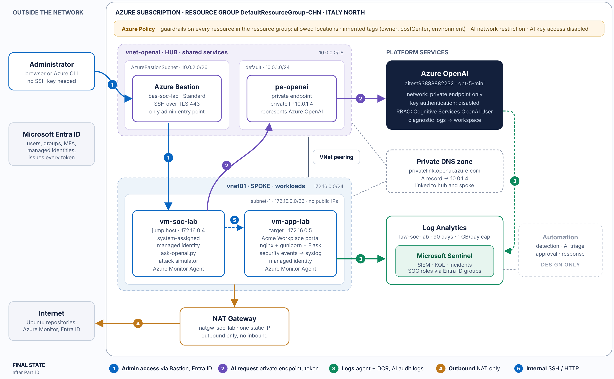
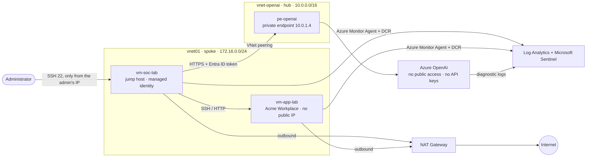
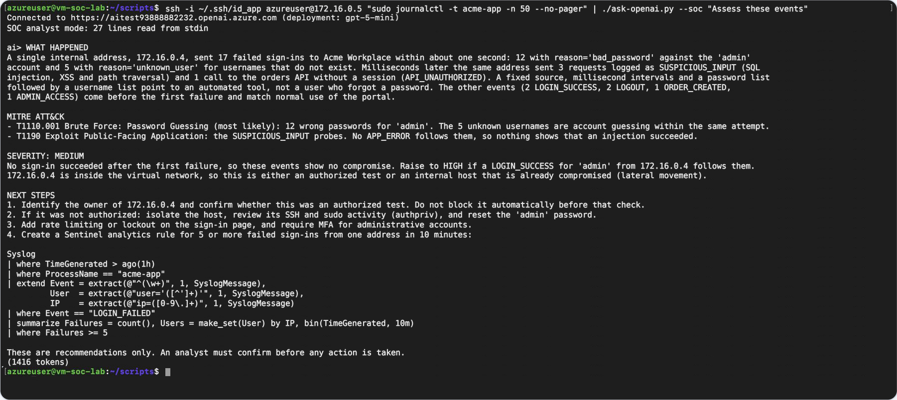

# Private AI for the SOC on Azure

**Keyless Azure OpenAI over Private Link, with a security log pipeline into Log Analytics and Microsoft Sentinel.**

A Security Operations Center (SOC) wants to use a language model to triage security events. Those events are among the most sensitive data a company holds: usernames, IP addresses, the traces of an attack in progress. An AI endpoint is also a new attack surface, with one more API that can be reached from the internet and one more key that can leak.

This project answers one question: **how can a SOC use a language model on its security data without creating a new way in?** The answer combines three ideas:

1. **The model has no public path.** It is reachable only from inside a private network.
2. **The model has no API keys.** Every caller proves who it is with a Microsoft Entra ID token, and holds only the permission it needs.
3. **The model sits next to the evidence.** The workload's security logs flow into Log Analytics and Microsoft Sentinel, and the same events can be handed to the model for a first assessment.

| Document | What it is for |
| --- | --- |
| [docs/tutorial.md](docs/tutorial.md) | Build the lab step by step, with commands and a check for every step |
| [docs/Private-AI-for-the-SOC-on-Azure.pdf](docs/Private-AI-for-the-SOC-on-Azure.pdf) | The full guide: design decisions, screenshots, known limitations |



*The final architecture, after Part 10. Administrators enter only through Azure Bastion with Entra ID (1), the jump host calls the model through the private endpoint with a token (2), both VMs and Azure OpenAI send their logs to Log Analytics and Sentinel (3), outbound traffic leaves only through the NAT Gateway (4), and the jump host administers the target over the private network (5).*

During the build phase (Parts 3 to 9), before Bastion exists, the jump host is reached over SSH from the administrator's IP only:



---

## The concepts behind the project

### 1. Governance and access: the first step

Governance and access come first, because every later resource is evaluated and accessed under them.

- **Azure Policy** turns design rules into checks the platform enforces. *Allowed locations* denies resources outside the chosen region. *Inherit a tag* adds the owner, cost-center and environment tags automatically. Two Azure AI Services policies cover a model that is open to all networks or still accepts keys: *Audit* while Part 1 secures the resource one control at a time, then *Deny*, so a non-compliant AI resource cannot be created at all. The policies are assigned before any other resource exists.
- **Roles go to Entra ID groups, never to people.** `grp-soc-analysts` holds *Sentinel Responder* (manage incidents, but not delete them), `grp-soc-engineers` holds *Sentinel Contributor* plus model access, `grp-soc-readers` holds *Sentinel Reader*, and `grp-vm-admins` holds *Virtual Machine Administrator Login*. Joiners and leavers are handled by membership alone, and MFA applies to every sign-in.
- **Costs have limits from day one:** a budget with alerts, a daily ingestion cap, a fixed retention period, and one resource group that can be deleted in a single operation.

### 2. Two doors into Azure OpenAI: control plane and data plane

Every Azure OpenAI resource exposes two separate interfaces.

- The **control plane** (`management.azure.com`) is where the resource is created, its network is configured, models are deployed and keys are listed. Azure RBAC protects it and Azure Policy governs it.
- The **data plane** (`https://<name>.openai.azure.com`) is where prompts go in and completions come out.

The difference matters because the security controls of this project act on the data plane. When the network is closed, the Azure portal can still open and configure the resource, because the portal uses the control plane. A user who holds *Owner* on the resource still cannot send a prompt, because Owner grants control-plane actions only.

Applications never call a model directly. They call a **deployment**, a named instance of one model version (`gpt-5-mini` here) with its own token-per-minute quota. The deployment type decides where prompts are processed. *Data Zone* keeps processing inside the EU, which matters because security logs contain personal data under GDPR.

### 3. Private Link: bringing the service into your network

A **private endpoint** is a network interface in your own subnet with a private IP address (`10.0.1.4` here). Every packet sent to that address is delivered to Azure OpenAI over the Microsoft backbone and never crosses the internet. The connection works in one direction only: clients in the network can reach the service, but the service cannot open a connection into the network.

Once the private endpoint exists, the resource's **public network access is disabled**, so the endpoint becomes the only path to the model. The test is simple: the Azure AI Foundry playground in a normal browser is refused with **403**, because it calls the data plane from a public IP.

### 4. Private DNS: same name, different answer

Applications keep using the normal hostname, `<name>.openai.azure.com`. Public DNS answers that name with an alias, `<name>.privatelink.openai.azure.com`. A **private DNS zone** called `privatelink.openai.azure.com` holds an A record that maps the alias to `10.0.1.4`.

A virtual network uses the zone only if it is **linked** to it. Inside a linked network the name resolves to the private address, and anywhere else it resolves to the public address, where the firewall refuses the request. This is called *split-horizon DNS*. A missing link is the most common failure: the VM resolves the public address and every call fails with 403. `nslookup` from the VM is therefore the first check.

### 5. Hub and spoke: where things live

The network follows the hub-and-spoke model of the Microsoft Cloud Adoption Framework.

- The **hub** (`vnet-openai`, `10.0.0.0/16`) holds shared services: the private endpoint and Azure Bastion.
- The **spoke** (`vnet01`, `172.16.0.0/24`) holds the workloads: the jump host `vm-soc-lab` (`172.16.0.4`) and the target `vm-app-lab` (`172.16.0.5`).

A **VNet peering** joins the two over the Microsoft backbone. Peering is not transitive, so a second spoke could not reach this one through the hub, which keeps workloads isolated by default.

Traffic is still filtered by **network security groups (NSGs)**. Every NSG ends with three default rules. `AllowVnetInBound` accepts traffic from the virtual network and peered networks, and `DenyAllInBound` refuses everything else, including the whole internet. The first of these lets Bastion in the hub reach the VMs in the spoke. It would also let any compromised VM reach every port of the others, so the target's NSG adds explicit rules: SSH and HTTP only from the jump host, SSH from the Bastion subnet, and a deny for the rest of the virtual network.

Every VM has a **private IP** on its subnet; that is how the jump host, Bastion and the peering reach it. What the target never has is a **public IP**.

### 6. NAT Gateway: out, but never in

The VMs need outbound internet access to install packages and to send their logs, but nothing on the internet should reach them. A **NAT Gateway** on the workload subnet translates every outbound connection to one static public address and translates the replies back. It never forwards a connection that started outside, so no inbound path exists. Every machine also leaves from one known address that partners can allow-list. The check is `curl ifconfig.me` on the target, which must print the NAT Gateway's address.

### 7. Keyless access: managed identity and Entra ID tokens

Azure OpenAI accepts two kinds of credentials:

| | API key | Entra ID token |
| --- | --- | --- |
| Identifies a caller | No | Yes, one specific identity |
| Expires | Never | On its own, after about an hour |
| Authorized by | Holding it is enough | RBAC on the resource |
| Appears in the logs as | Anonymous | That identity |

Setting `disableLocalAuth` to `true` turns keys off, so only tokens are accepted.

A VM gets its token through a **system-assigned managed identity**: Azure creates an identity in Entra ID tied to that VM, and the VM asks for a token from the **Instance Metadata Service** at `169.254.169.254`, which is reachable only from inside the VM. No secret is ever written to disk. The token is a JSON Web Token whose claims say who issued it (the tenant), for which service (`cognitiveservices.azure.com`), for which identity, and until when.

### 8. Least privilege: Actions versus DataActions

An Azure role assignment joins a **principal**, a **role** and a **scope**. Roles separate **Actions**, which are control-plane operations such as listing keys, from **DataActions**, which are data-plane operations such as sending a prompt.

The VM's identity holds **Cognitive Services OpenAI User** on the Azure OpenAI resource only. Its DataActions allow inference, and its Actions are read-only, so a compromised VM can use the model but cannot list keys, change the network or create deployments.

One request proves the whole chain: a data-plane call from the VM that returns **200** shows that the name resolved privately, the traffic took the private path, Entra ID authenticated the VM and RBAC authorized it.

### 9. Two machines, two roles

- **`vm-soc-lab`, the jump host:** the administrative machine. It calls the model, administers the target and plays the attacker in the simulation.
- **`vm-app-lab`, the target:** *Acme Workplace*, a small internal portal (nginx, gunicorn, Flask) that writes security events. It has no public IP and is reached only from inside the network.

Keeping them separate means administration and the monitored workload never share a role. The application itself follows production practice: nginx as a reverse proxy, gunicorn listening only on localhost, the service running as the unprivileged `www-data` user, and its session secret in a root-only file.

**Build phase versus final state.** While the lab is being built, the jump host has a temporary public IP with SSH allowed from the administrator's address only. Part 10 replaces it with **Azure Bastion** and **Entra ID login**, then removes the public IP, the SSH rule and every SSH key. Bastion is a managed service in the hub: the administrator connects to it over TLS on port 443 with their Entra ID identity, protected by MFA. Bastion then opens SSH to the VM's private address, and the VM accepts a short-lived certificate instead of a key file. Administrators hold *Reader* only on the VMs, their network interfaces and Bastion, not on the whole resource group. No VM has a public IP, and removing someone from a group removes their access to every machine at once.

### 10. The log pipeline: from a syslog line to Microsoft Sentinel

- **Structured events.** The application writes one key-value line per event to the `auth` syslog facility with the tag `acme-app`, for example `LOGIN_FAILED user='admin' ip=172.16.0.4 reason='bad_password'`. The events cover sign-ins, privilege and access denials, admin activity and suspicious input such as SQL injection, XSS or path traversal patterns.
- **Azure Monitor Agent and the Data Collection Rule (DCR).** The agent runs on each VM and authenticates with the VM's managed identity. The DCR is an Azure resource that decides which syslog facilities leave the servers, at which minimum severity, and where they go. `auth`, `authpriv` (SSH, sudo) and `local7` (nginx) are collected from `info` upwards. `cron`, `daemon`, `kern` and the rest are collected from `warning` upwards, to catch persistence and tampering without the noise.
- **Log Analytics.** The workspace stores the data in tables (`Syslog`, `Heartbeat`, `AzureDiagnostics`) and is queried with **KQL**. A 90-day retention and a daily ingestion cap are set before any data arrives.
- **Microsoft Sentinel.** Sentinel turns the workspace into a SIEM: analytics rules run KQL on a schedule, alerts become incidents with entities (accounts, IPs, hosts), and playbooks act on them.
- **The AI service is monitored too.** A diagnostic setting sends Azure OpenAI's own request logs to the same workspace. They record who called the model, when and with which result, but not the prompts.

### 11. Proving it: an attack you can see

A control that is not tested is only an assumption. `scripts/simulate-attack.sh` runs from the jump host against the portal:

- 12 wrong passwords for `admin`: MITRE ATT&CK **T1110.001**, password guessing
- 5 common usernames that do not exist: account discovery
- SQL injection, XSS and path traversal probes
- a call to the orders API without a session

KQL then turns the raw lines into columns (event, user, source IP) with `extract()`, and a summary shows **17 `LOGIN_FAILED`, 3 `SUSPICIOUS_INPUT` and 1 `API_UNAUTHORIZED`**, all from one internal address. That address is exactly the field a brute-force detection rule groups on.

### 12. The model as a triage assistant

`scripts/ask-openai.py` is a small client written with the Python standard library only. Before every request it takes a fresh token from the metadata service, so the keyless flow is visible step by step. In **SOC analyst mode**, a system message asks the model to explain what happened, name the most likely ATT&CK technique, judge the severity, and propose next steps and a KQL query. Piping the application's latest events into the script gives the analyst a first assessment in plain language, without leaving the private network.



*Illustration: the kind of assessment SOC mode returns for the attack events (tutorial step 9.4, guide slide 86). The wording varies between runs.*

Two principles keep this safe:

- **The model returns text only.** It cannot run commands or change any resource, and the analyst decides.
- **Log content is attacker-controlled.** A username can contain text written to manipulate the model (*prompt injection through logs*), so the output is always read critically and never triggers an action on its own.

---

## Next step: automation (designed, not deployed)

A Sentinel analytics rule raises an incident on 5 or more failed sign-ins from one address in 10 minutes (T1110). A playbook on Logic Apps Standard with VNet integration, because the Consumption plan cannot reach a private endpoint, sends the incident to the private model with its own managed identity and writes the assessment on the incident. The analyst approves or dismisses a temporary block, which never covers the administrator or Bastion ranges and removes itself after a set period.

## Known limitations of the lab as built

A review after the build found these gaps. The guide's **Known limitations** slide gives the fix for each.

- During the build phase, the jump host reached the target with a shared, passphrase-less key as `azureuser`. Part 10 removes it.
- Application events use a key-value format parsed with regular expressions, so attacker-controlled values could spoof the parsed source IP. JSON with `parse_json()` is the fix.
- Azure Activity, Entra ID and Bastion logs were not sent to the workspace.
- Everything was built with the portal and the Azure CLI, without infrastructure as code.

---

## Repository layout

```
docs/       tutorial.md, the guide (PDF), architecture-as-built.png, images/ (screenshots, architecture-final.png)
app/        Acme Workplace and its deployment files (deploy/install.sh)
scripts/    ask-openai.py (keyless chat client), simulate-attack.sh
kql/        pipeline check and attack-analysis queries
infra/      teardown.sh
```

## Author

**GabriSec** · [LinkedIn](https://www.linkedin.com/in/your-profile) · October 2026
