# Build the lab: Private AI for the SOC on Azure

In this tutorial I build a private, keyless Azure OpenAI deployment that a security team can use from inside its own network, plus a log pipeline that brings a workload's security events into Log Analytics and Microsoft Sentinel. The [README](../README.md) explains the concepts behind the project, and the [full guide (PDF)](Private-AI-for-the-SOC-on-Azure.pdf) explains every design decision slide by slide. This file is the hands-on part: where to go in the Azure portal, what to click, what to type, and how to check that each step worked. Every portal step is followed by the same action with the Azure CLI, so you can use either.

I built everything in Italy North in October 2026, and the screenshots come from that build, with sensitive values (subscription, tenant and object IDs, public IP addresses) blacked out. The step numbers match the guide, so you can read the two side by side.

## What you will build


*The final architecture, after Part 10. (1) Administrators enter only through Azure Bastion with their Entra ID identity. (2) The jump host calls Azure OpenAI through the private endpoint with a managed identity token. (3) Both VMs send their logs through the Azure Monitor Agent, and Azure OpenAI its diagnostic logs, to Log Analytics and Microsoft Sentinel. (4) Outbound traffic leaves only through the NAT Gateway. (5) The jump host administers the target over the private network. Azure Policy governs every resource in the resource group.*

During Parts 3 to 9, before Bastion exists, the jump host also has a temporary public IP with SSH allowed only from my own address. Part 10 replaces that with Azure Bastion and Entra ID login and removes every public entry point.

| Part | Result |
| --- | --- |
| 0 | Resource group with ownership tags and Azure Policy guardrails |
| 1 | Azure OpenAI reachable only through a private endpoint, keys disabled, AI policies on Deny |
| 2 | Hub-and-spoke network, peering, private DNS link, NAT Gateway |
| 3 | Jump host with a managed identity |
| 4 | Keyless call to the model through RBAC |
| 5 | `ask-openai.py`, an operator tool on the private path |
| 6 | Log Analytics, Microsoft Sentinel, SOC groups in Entra ID |
| 7 | Target VM with the Acme Workplace application |
| 8 | Log collection with the Azure Monitor Agent |
| 9 | Pipeline check, attack simulation in KQL, AI assessment |
| 10 | Azure Bastion with Entra ID login, public access removed |

## Before you start

- An Azure subscription where you hold **Owner**, or Contributor plus User Access Administrator, on the resource group you will create.
- Permission to create security groups in Microsoft Entra ID (Part 6).
- A web browser for the Azure portal, Azure Cloud Shell (Bash) for the Azure CLI commands, and a terminal with an SSH client on your computer.
- This repository cloned on your computer. It provides `app/`, `scripts/` and `kql/`.
- A **budget with alerts** in **Cost Management > Budgets**, created before anything else, with alerts at 50, 80 and 100 percent. The VMs, Bastion and the NAT Gateway bill per hour, Log Analytics bills per GB ingested, and Azure OpenAI bills per token.
- In Azure AI Foundry, check that the model you want is offered in your region and for the deployment type you plan to use.

Commands run in **Cloud Shell** unless the block starts with `# on your computer`, `# on vm-soc-lab` or `# on vm-app-lab`.

### Names

| Resource | Name in this tutorial | Name in my screenshots |
| --- | --- | --- |
| Resource group | `rg-soc-lab` | `DefaultResourceGroup-CHN` |
| Azure OpenAI | `aoai-soc-lab-…` (globally unique) | `aitest93888882232` |
| Everything else | `vnet-openai`, `vnet01`, `pe-openai`, `natgw-soc-lab`, `vm-soc-lab`, `vm-app-lab`, `law-soc-lab`, `dcr-soc-lab-syslog`, `bas-soc-lab` | same |

Region: **Italy North**. VM size: **Standard D2alds_v7**, or any small size you have quota for. Placeholders are written in angle brackets, for example `<AOAI>` for your Azure OpenAI name or `<APP_PRIVATE_IP>` for the target VM's private address.

The Azure CLI commands use these variables. Cloud Shell forgets variables when the session restarts, so I keep them in a file and reload it with `source ~/soc-lab.env`:

```bash
cat > ~/soc-lab.env <<'EOF'
RG=rg-soc-lab
LOC=italynorth                     # or the region you prefer
AOAI=aoai-soc-lab-CHANGE-ME        # globally unique, lowercase: it becomes the endpoint hostname
WS=law-soc-lab
VM_SIZE=Standard_D2alds_v7         # any small size you have quota for
EOF
source ~/soc-lab.env
```

Some steps save resource IDs into the same file (`echo "OAI_ID=..." >> ~/soc-lab.env`), so later steps can use them.

---

## Part 0 · Governance baseline

I create the resource group first and assign the policies before any other resource exists, so every resource is evaluated from the moment it is created.

### 0.1 Create the resource group

1. In the portal, open **Resource groups** and select **+ Create**.
2. **Basics:** choose your subscription, name `rg-soc-lab`, region **Italy North** (or the region you prefer).
3. **Tags:** add `environment = lab`, `workload = soc`, `owner = <your name>` and `costCenter = <your cost center>`.
4. Select **Review + create**, then **Create**.

**With the Azure CLI**

```bash
az group create -n $RG -l $LOC \
  --tags environment=lab workload=soc owner="<your name>" costCenter="<your cost center>"
echo "RG_ID=$(az group show -n $RG --query id -o tsv)" >> ~/soc-lab.env && source ~/soc-lab.env
```

The tags record who owns the environment and which budget pays for it. Part 0.2 copies three of them onto every resource automatically.

### 0.2 Assign the policy definitions

All four assignments are made the same way: open **Policy**, then **Authoring > Assignments**, and select **Assign policy**. On the **Basics** tab, set **Scope** to your subscription and the resource group `rg-soc-lab`, then pick the **Policy definition** with the **…** button by searching for its name. On the **Parameters** tab, clear **Only show parameters that need input or review** so every parameter is visible.

**Allowed locations** (effect Deny)

1. Policy definition: **Allowed locations**. Assignment name: `allowed-locations`.
2. **Parameters:** in **Allowed locations**, select only **Italy North**.
3. **Review + create**, then **Create**.

From now on, a resource created in any other region is rejected before it exists. Global resources such as private DNS zones are exempt by design.

**Inherit a tag from the resource group if missing** (effect Modify), once for each tag

1. Policy definition: **Inherit a tag from the resource group if missing**. Assignment name: `inherit-owner-tag`.
2. **Parameters:** **Tag Name** = `owner`.
3. **Remediation:** tick **Create a remediation task**, keep **System assigned managed identity** and set its location to **Italy North** (or the region you chose). The portal gives that identity the **Contributor** role the policy needs to add the tag.
4. **Review + create**, then **Create**.
5. Repeat with `costCenter` (`inherit-costCenter-tag`) and `environment` (`inherit-environment-tag`).

A Modify policy changes only resources created or updated after it is assigned; the remediation task adds the tag to the ones that already exist.

**Azure AI Services: network access and key access** (effect Audit, switched to Deny in step 1.7)

1. Policy definition: **Azure AI Services resources should restrict network access**. Assignment name: `aisvc-restrict-network-access`. On **Parameters**, leave **Effect** on **Audit**. **Review + create**, then **Create**.
2. Policy definition: **Azure AI Services resources should have key access disabled (disable local authentication)**. Assignment name: `aisvc-key-access-disabled`. Leave **Effect** on **Audit**. **Review + create**, then **Create**.

I start with Audit because Part 1 creates the Azure OpenAI resource first and secures it one control at a time. With Deny, the creation in step 1.1 would be refused. Once Part 1 has closed the network and disabled the keys, step 1.7 switches both to Deny.

**With the Azure CLI**

```bash
# finds a built-in definition by its display name
defid() { az policy definition list --query "[?displayName=='$1'].name | [0]" -o tsv; }

# Allowed locations (Deny)
az policy assignment create --name allowed-locations --scope "$RG_ID" \
  --policy "$(defid 'Allowed locations')" \
  --params "{\"listOfAllowedLocations\":{\"value\":[\"$LOC\"]}}"

# Inherit the three tags (Modify), each with a managed identity and a remediation task
for t in owner costCenter environment; do
  az policy assignment create --name "inherit-$t-tag" --scope "$RG_ID" \
    --policy "$(defid 'Inherit a tag from the resource group if missing')" \
    --params "{\"tagName\":{\"value\":\"$t\"}}" \
    --mi-system-assigned --location $LOC --identity-scope "$RG_ID" --role Contributor
  az policy remediation create -n "fix-$t-tag" --policy-assignment "inherit-$t-tag" -g $RG
done

# Azure AI Services: network access and key access (default effect Audit)
az policy assignment create --name aisvc-restrict-network-access --scope "$RG_ID" \
  --policy "$(defid 'Azure AI Services resources should restrict network access')"
az policy assignment create --name aisvc-key-access-disabled --scope "$RG_ID" \
  --policy "$(defid 'Azure AI Services resources should have key access disabled (disable local authentication)')"

# compliance summary for the resource group
az policy state summarize -g $RG --query "results.resourceDetails" -o table
```

**Check:** open **Policy > Compliance** and filter on `rg-soc-lab`. The five assignments appear, and the first evaluation completes within about 30 minutes. By the end of Part 1, Azure OpenAI is compliant with both AI policies and every resource carries the three tags.

Before assigning a definition, you can open it under **Policy > Authoring > Definitions** (filter **Type** on **Built-in**) to read its rule:

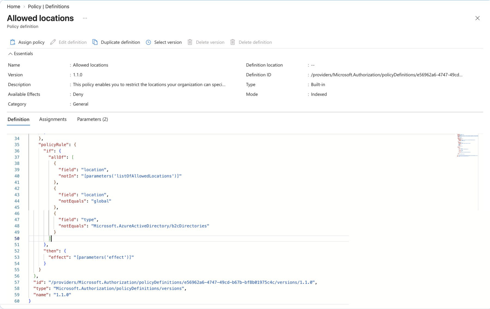

*Allowed locations: the location must be in listOfAllowedLocations, global resources excepted. The only effect is Deny.*

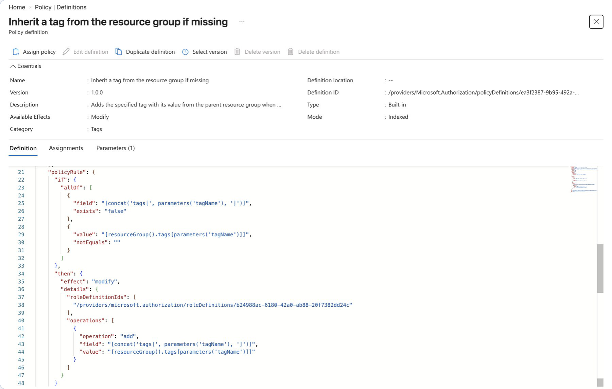

*Inherit a tag from the resource group if missing: Modify, with the Contributor role (b24988ac-…) that the assignment's managed identity needs.*

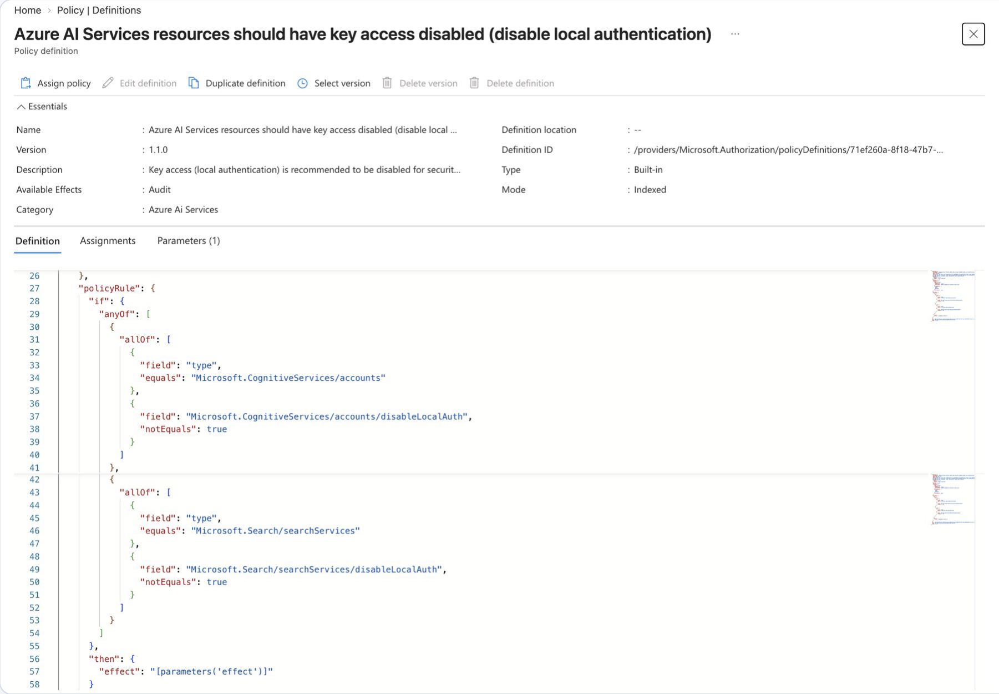

*Azure AI Services key access: matches accounts whose disableLocalAuth is not true. The default effect is Audit.*

---

## Part 1 · Azure OpenAI behind a private endpoint

### 1.1 Create the Azure OpenAI resource

1. Search for **Azure OpenAI** and select **+ Create**.
2. **Basics:** resource group `rg-soc-lab`, region **Italy North**, a globally unique name (it becomes the endpoint hostname, `https://<AOAI>.openai.azure.com`), pricing tier **Standard S0**.
3. **Network:** leave the default for now. Steps 1.3 and 1.4 close it.
4. **Review + submit**, then **Create**.

**With the Azure CLI**

```bash
az cognitiveservices account create -g $RG -n $AOAI -l $LOC \
  --kind OpenAI --sku S0 --custom-domain $AOAI --yes
echo "OAI_ID=$(az cognitiveservices account show -g $RG -n $AOAI --query id -o tsv)" >> ~/soc-lab.env && source ~/soc-lab.env
```

The resource name becomes the custom subdomain that Entra ID authentication requires. Standard S0 is pay-per-token, with no fixed monthly cost.

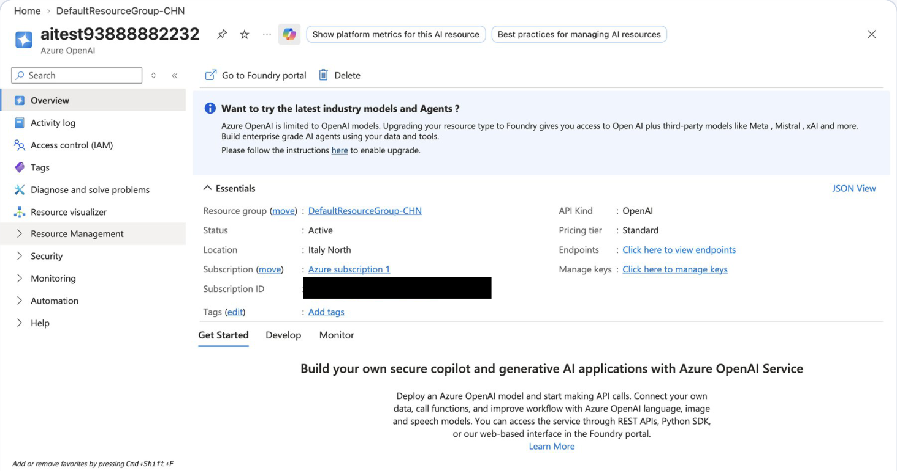

*The Azure OpenAI resource (Standard tier, Italy North), captured before the tag policy had added its tags.*

### 1.2 Deploy the model

1. On the resource's **Overview**, select **Go to Azure AI Foundry portal**.
2. Open **Deployments**, select **+ Deploy model > Deploy base model**, choose **gpt-5-mini** and select **Confirm**.
3. Deployment name `gpt-5-mini`. **Deployment type:** *Data Zone Standard* keeps processing inside the EU data zone; *Standard* keeps it in the resource's region; *Global Standard* lets Microsoft route requests to any region. Set a low **tokens-per-minute** limit: a lab needs very little.
4. Select **Deploy**.

**With the Azure CLI**

```bash
# --sku-name: DataZoneStandard (EU data zone), Standard (resource region) or GlobalStandard
az cognitiveservices account deployment create -g $RG -n $AOAI \
  --deployment-name gpt-5-mini --model-name gpt-5-mini --model-version 2025-08-07 \
  --model-format OpenAI --sku-name DataZoneStandard --sku-capacity 10
```

I choose the deployment type deliberately: security logs contain usernames and IP addresses, which are personal data under GDPR.

**Check** from Cloud Shell:

```bash
az cognitiveservices account deployment list -g $RG -n $AOAI -o table
```

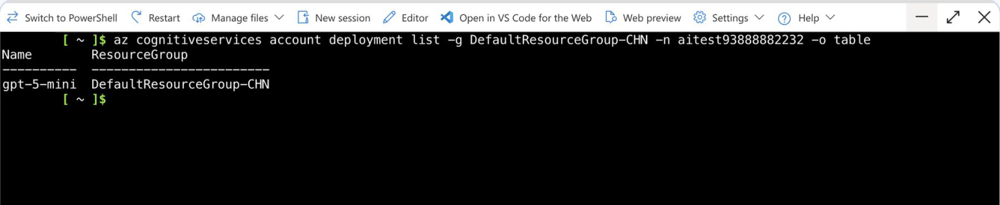

*The deployment listed from Cloud Shell.*

### 1.3 Close the public endpoint

1. In the Azure OpenAI resource, open **Resource Management > Networking**.
2. On **Firewalls and virtual networks**, set **Allow access from** to **Disabled**, and select **Save**.

**With the Azure CLI**

```bash
az resource update --ids "$OAI_ID" \
  --set properties.publicNetworkAccess=Disabled \
        properties.networkAcls='{"defaultAction":"Deny","ipRules":[],"virtualNetworkRules":[]}'
```

With public network access disabled, the only way to reach the data plane is a private endpoint, which I create in the next step. The portal still opens and configures the resource, because that uses the control plane.

### 1.4 Create the hub network and the private endpoint

First the hub network:

1. Open **Virtual networks**, select **+ Create**.
2. **Basics:** resource group `rg-soc-lab`, name `vnet-openai`, region **Italy North**.
3. **IP addresses:** address space `10.0.0.0/16`, with one subnet named `default`, `10.0.1.0/24`. Remove any other subnet the wizard proposes.
4. **Review + create**, then **Create**.

Then the private endpoint:

1. In the Azure OpenAI resource, open **Networking > Private endpoint connections** and select **+ Private endpoint**.
2. **Basics:** name `pe-openai`, region **Italy North**.
3. **Resource:** target sub-resource **account**.
4. **Virtual Network:** `vnet-openai`, subnet `default`.
5. **DNS:** **Integrate with private DNS zone** = **Yes**, zone `privatelink.openai.azure.com`.
6. **Review + create**, then **Create**.

**With the Azure CLI**

```bash
# hub network
az network vnet create -g $RG -n vnet-openai -l $LOC \
  --address-prefixes 10.0.0.0/16 --subnet-name default --subnet-prefixes 10.0.1.0/24

# private endpoint for the "account" sub-resource
az network private-endpoint create -g $RG -n pe-openai -l $LOC \
  --vnet-name vnet-openai --subnet default \
  --private-connection-resource-id "$OAI_ID" --group-id account --connection-name pe-openai-conn

# private DNS zone, linked to the hub, and the A record managed by the endpoint
az network private-dns zone create -g $RG -n privatelink.openai.azure.com
az network private-dns link vnet create -g $RG -z privatelink.openai.azure.com \
  -n link-vnet-openai -v vnet-openai -e false
az network private-endpoint dns-zone-group create -g $RG --endpoint-name pe-openai \
  -n default --private-dns-zone privatelink.openai.azure.com --zone-name openai

# checks: Approved, and the A record pointing to 10.0.1.4
az network private-endpoint show -g $RG -n pe-openai \
  --query "privateLinkServiceConnections[0].privateLinkServiceConnectionState.status" -o tsv
az network private-dns record-set a list -g $RG -z privatelink.openai.azure.com \
  --query "[].{name:name, ip:aRecords[0].ipv4Address}" -o table
```

**Check:** the connection state reads **Approved**, and the private DNS zone `privatelink.openai.azure.com` has an A record for the resource pointing to **10.0.1.4**.

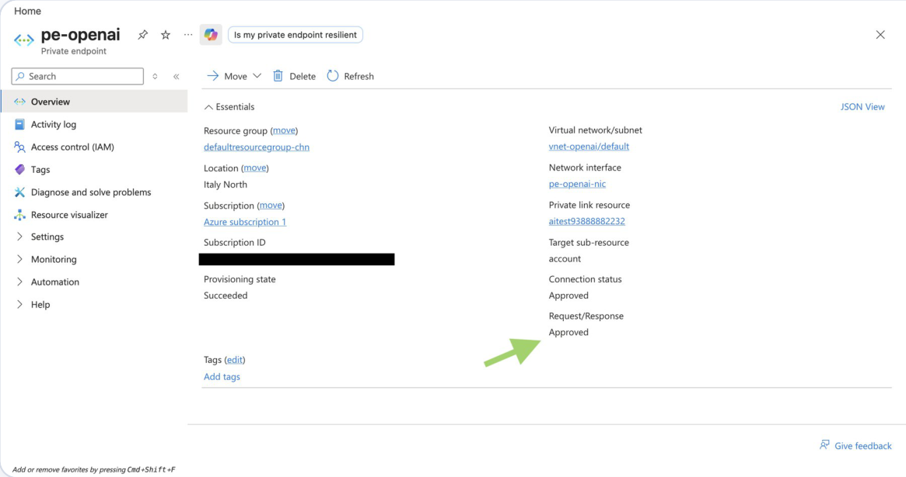

*pe-openai in vnet-openai/default, target sub-resource account, connection Approved.*

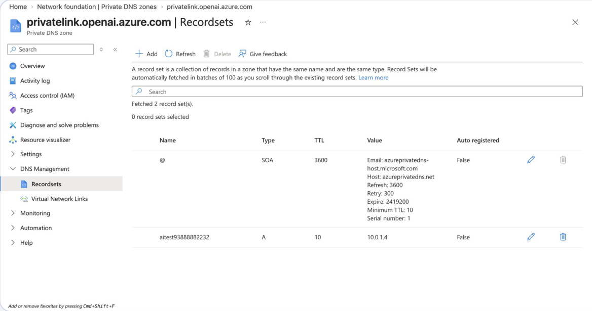

*The A record that maps the resource name to the private endpoint, 10.0.1.4.*

### 1.5 Disable key-based authentication

The portal has no switch for this setting, so this step is done only with the Azure CLI, from Cloud Shell:

```bash
az resource update --ids "$OAI_ID" --set properties.disableLocalAuth=true
az cognitiveservices account show -g $RG -n $AOAI --query properties.disableLocalAuth   # true
```

The two API keys still exist on the control plane, but any request that presents one is rejected. From now on every call needs an Entra ID token, is authorized by RBAC and is logged under an identity. In **Policy > Compliance**, the key access policy now reports the resource as compliant.

### 1.6 Prove the model is unreachable from outside

Open the deployment in the **Azure AI Foundry chat playground** on your computer and send a message. The playground calls the data plane from your public IP, so it must fail with **403**.

**With the Azure CLI.** Cloud Shell also runs outside your network, so the same call from there must be refused:

```bash
TOKEN=$(az account get-access-token --resource https://cognitiveservices.azure.com --query accessToken -o tsv)
curl -s -o /dev/null -w "%{http_code}\n" -H "Authorization: Bearer $TOKEN" \
  "https://$AOAI.openai.azure.com/openai/models?api-version=2024-10-21"     # 403
```

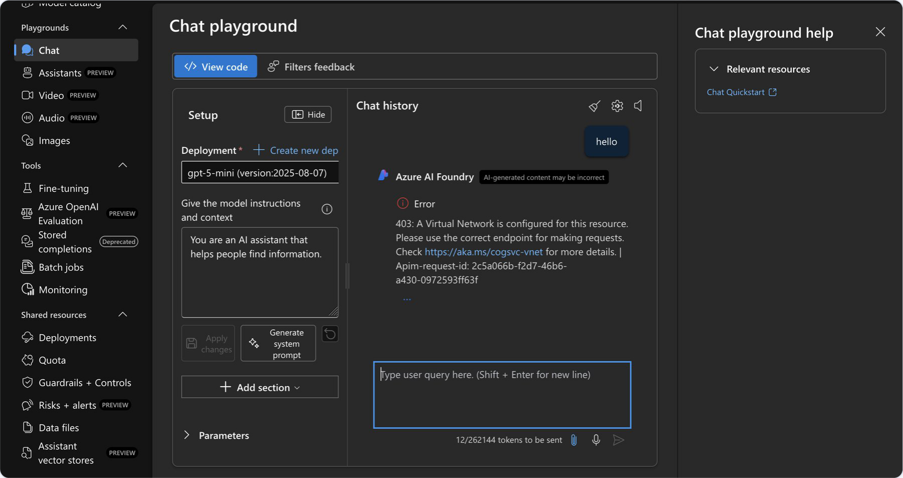

*The playground on my computer is refused with 403, "A Virtual Network is configured for this resource".*

### 1.7 Switch the AI policies to Deny

Now that both AI settings are compliant, Audit has done its job: it only reports a bad resource after it exists. Deny stops it from existing.

1. Open **Policy > Authoring > Assignments** and select `aisvc-restrict-network-access`.
2. Select **Edit assignment**, open **Parameters**, clear **Only show parameters that need input or review**, and set **Effect** to **Deny**.
3. **Review + save**, then **Save**.
4. Repeat for `aisvc-key-access-disabled`.

**With the Azure CLI**

```bash
# an assignment's effect is set at creation, so each one is recreated with Deny
defid() { az policy definition list --query "[?displayName=='$1'].name | [0]" -o tsv; }
for a in "aisvc-restrict-network-access:Azure AI Services resources should restrict network access" \
         "aisvc-key-access-disabled:Azure AI Services resources should have key access disabled (disable local authentication)"; do
  NAME=${a%%:*}; DISPLAY=${a#*:}
  az policy assignment delete --name "$NAME" --scope "$RG_ID"
  az policy assignment create --name "$NAME" --scope "$RG_ID" \
    --policy "$(defid "$DISPLAY")" --params '{"effect":{"value":"Deny"}}'
done

# check: a new Azure OpenAI resource with public access and keys must be refused
az cognitiveservices account create -g $RG -n "$AOAI-test" -l $LOC --kind OpenAI --sku S0 --yes
# expected: RequestDisallowedByPolicy
```

**Check:** try to create another Azure OpenAI resource in `rg-soc-lab` with network access set to **All networks**. The validation fails with **RequestDisallowedByPolicy**. Cancel it.

---

## Part 2 · Spoke network, peering, DNS and outbound

### 2.1 Address plan

| Network / subnet | Role | Range |
| --- | --- | --- |
| `vnet-openai` (hub) | Shared services | `10.0.0.0/16` |
| `vnet-openai/default` | Private endpoint | `10.0.1.0/24` |
| `vnet-openai/AzureBastionSubnet` | Azure Bastion (Part 10) | `10.0.2.0/26` |
| `vnet01` (spoke) | Workloads | `172.16.0.0/24` |
| `vnet01/subnet-1` | Both VMs | `172.16.0.0/26` |

Peered networks must not overlap. Bastion needs a subnet named exactly `AzureBastionSubnet`, of size /26 or larger.

Create the spoke the same way as the hub: **Virtual networks > + Create**, name `vnet01`, address space `172.16.0.0/24`, one subnet `subnet-1` with `172.16.0.0/26`.

**With the Azure CLI**

```bash
az network vnet create -g $RG -n vnet01 -l $LOC \
  --address-prefixes 172.16.0.0/24 --subnet-name subnet-1 --subnet-prefixes 172.16.0.0/26
```

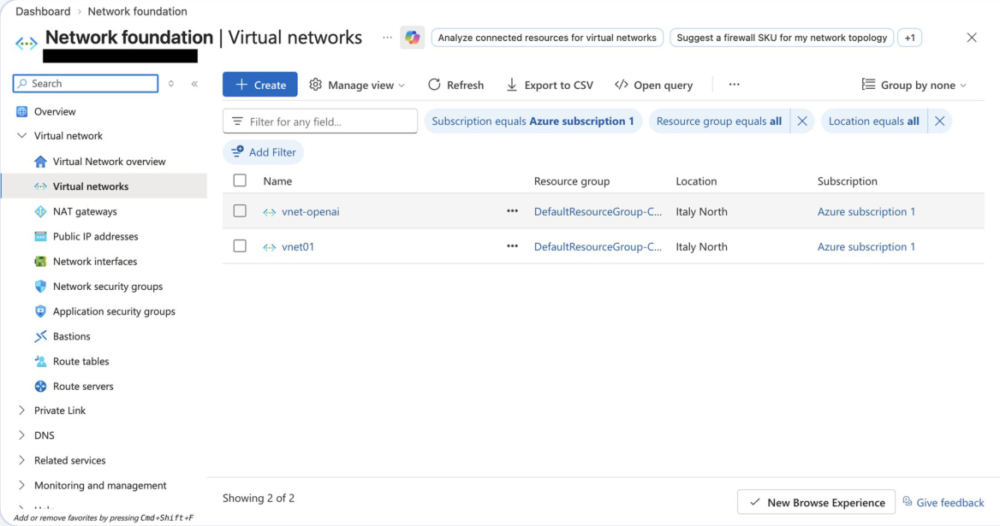

*The hub vnet-openai and the spoke vnet01.*

### 2.2 Peer the two networks

1. Open `vnet01`, then **Settings > Peerings**, and select **+ Add**.
2. **Remote virtual network:** link name `vnet-openai-to-vnet01`, virtual network `vnet-openai`, allow access to `vnet01`.
3. **Local virtual network:** link name `vnet01-to-vnet-openai`, allow access to `vnet-openai`.
4. Leave gateway transit and forwarded traffic off: there is no VPN gateway or appliance in the hub.
5. Select **Add**.

**With the Azure CLI**

```bash
az network vnet peering create -g $RG -n vnet01-to-vnet-openai \
  --vnet-name vnet01 --remote-vnet vnet-openai --allow-vnet-access true
az network vnet peering create -g $RG -n vnet-openai-to-vnet01 \
  --vnet-name vnet-openai --remote-vnet vnet01 --allow-vnet-access true

# check: Connected and FullyInSync
az network vnet peering list -g $RG --vnet-name vnet01 \
  --query "[].{name:name, state:peeringState, sync:peeringSyncLevel}" -o table
```

**Check:** the peering shows **Connected** and **Fully Synchronized**.

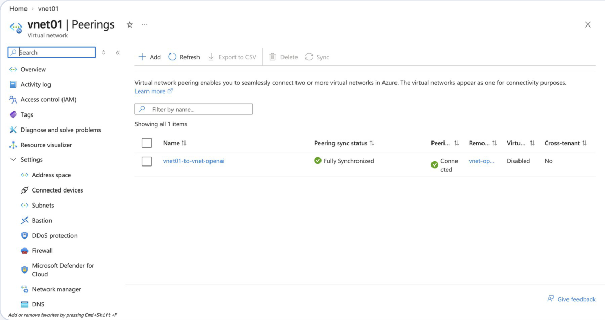

*vnet01-to-vnet-openai, Connected and Fully Synchronized.*

### 2.3 Link the private DNS zone to the spoke

A virtual network resolves a private zone only if it is linked to it. The private endpoint wizard linked the zone to the hub only, so without this step the VMs in the spoke would resolve the public address and be refused.

1. Open the private DNS zone `privatelink.openai.azure.com`, then **DNS Management > Virtual Network Links**, and select **+ Add**.
2. Link name `link-vnet01`, virtual network `vnet01`, **Enable auto registration** off.
3. Select **Create**.

**With the Azure CLI**

```bash
az network private-dns link vnet create -g $RG -z privatelink.openai.azure.com \
  -n link-vnet01 -v vnet01 -e false

# check: both links Completed
az network private-dns link vnet list -g $RG -z privatelink.openai.azure.com \
  --query "[].{name:name, state:virtualNetworkLinkState}" -o table
```

**Check:** both links show **Completed**.

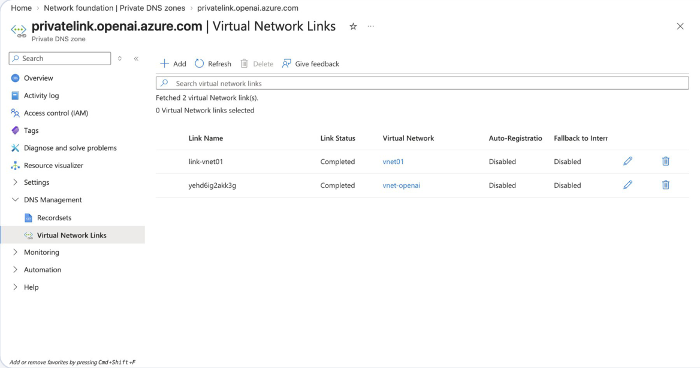

*The zone linked to both networks, auto-registration disabled. The hub link name was generated by the private endpoint wizard.*

### 2.4 Add a NAT Gateway for outbound traffic

1. Open **NAT gateways**, select **+ Create**.
2. **Basics:** name `natgw-soc-lab`, region **Italy North**, SKU **Standard**, availability zone **1** (the same zone as the VMs), TCP idle timeout **4** minutes. The portal may propose the zone-redundant *Standard V2* SKU instead, which also works.
3. **Outbound IP:** **Add public IP addresses or prefixes > Create a new public IP address**, name `pip-natgw-soc-lab`.
4. **Networking:** virtual network `vnet01`, subnet `subnet-1`.
5. **Review + create**, then **Create**.

**With the Azure CLI**

```bash
az network public-ip create -g $RG -n pip-natgw-soc-lab \
  --sku Standard --allocation-method Static --zone 1
az network nat gateway create -g $RG -n natgw-soc-lab \
  --public-ip-addresses pip-natgw-soc-lab --idle-timeout 4 --zone 1
az network vnet subnet update -g $RG --vnet-name vnet01 -n subnet-1 --nat-gateway natgw-soc-lab
```

The VMs get outbound access for packages and telemetry from one static address, and nothing can connect in through the gateway. The check is in step 7.2.

---

## Part 3 · Jump host

### 3.1 Create vm-soc-lab

Open **Virtual machines > + Create > Azure virtual machine**. Settings not listed keep their defaults.

| Tab | Field | Value |
| --- | --- | --- |
| Basics | Resource group / name | `rg-soc-lab` / `vm-soc-lab` |
| Basics | Region / availability zone | Italy North, zone 1 only |
| Basics | Security type | Trusted launch, Secure Boot and vTPM enabled |
| Basics | Image / size | Ubuntu Server 24.04 LTS – x64 Gen2 / Standard D2alds_v7 |
| Basics | Authentication | SSH public key, user `azureuser`, **Generate new key pair**, name `vm-soc-lab_key` |
| Basics | Public inbound ports | Allow selected ports, **SSH (22)**: restricted in 3.2, removed in Part 10 |
| Disks | OS disk | Premium SSD or Standard SSD, **Delete with VM** ticked |
| Networking | Virtual network / subnet | `vnet01` / `subnet-1` (do not keep the network the wizard proposes) |
| Networking | Public IP | New, `vm-soc-lab-ip`, for the build phase only |
| Networking | Delete public IP and NIC when VM is deleted | Ticked |
| Management | System assigned managed identity | **Enabled** |
| Monitoring | Boot diagnostics / OS guest diagnostics | Managed storage / Off: logs come from the DCR in Part 8 |

Select **Review + create**, then **Create**. The portal offers the private key (`vm-soc-lab_key.pem`) for download exactly once, so save it before closing the page.

**With the Azure CLI**

```bash
# the key pair, created in Cloud Shell: download ~/vm-soc-lab_key afterwards
# (Manage files > Download) and save it on your computer as ~/Downloads/vm-soc-lab_key.pem
ssh-keygen -t rsa -b 4096 -f ~/vm-soc-lab_key -N "" -C vm-soc-lab-admin

# NSG with the SSH rule, already restricted to your public IP (run `curl -s ifconfig.me` on your computer)
MYIP="<your public IP>"
az network nsg create -g $RG -n vm-soc-lab-nsg -l $LOC
az network nsg rule create -g $RG --nsg-name vm-soc-lab-nsg -n SSH --priority 300 \
  --direction Inbound --access Allow --protocol Tcp \
  --source-address-prefixes "$MYIP/32" --destination-port-ranges 22

az vm create -g $RG -n vm-soc-lab -l $LOC --zone 1 \
  --image Ubuntu2404 --size $VM_SIZE \
  --security-type TrustedLaunch --enable-secure-boot true --enable-vtpm true \
  --vnet-name vnet01 --subnet subnet-1 \
  --public-ip-address vm-soc-lab-ip --public-ip-sku Standard \
  --nsg vm-soc-lab-nsg \
  --admin-username azureuser --ssh-key-values ~/vm-soc-lab_key.pub \
  --assign-identity \
  --os-disk-delete-option Delete --nic-delete-option Delete
```

The system-assigned managed identity is how the VM will call Azure OpenAI without any stored secret.

### 3.2 Restrict SSH to your own IP

> [!NOTE]
> **This access is temporary.** The public IP and this SSH rule exist only for the build phase, Parts 3 to 9, because Bastion does not exist yet. In Part 10 I remove both, together with the SSH keys, and from then on the only way into the VMs is Azure Bastion with Entra ID login.

1. In `vm-soc-lab`, open **Networking > Network settings**.
2. Select the inbound rule **SSH** (priority 300).
3. Set **Source** to **My IP address** and select **Save**.

**With the Azure CLI**

```bash
# needed only if the rule was created open, or if your public IP changes
az network nsg rule update -g $RG --nsg-name vm-soc-lab-nsg -n SSH \
  --source-address-prefixes "<your public IP>/32"
```

The rule now matches only your current public IP, and every other connection falls through to the default deny rule.

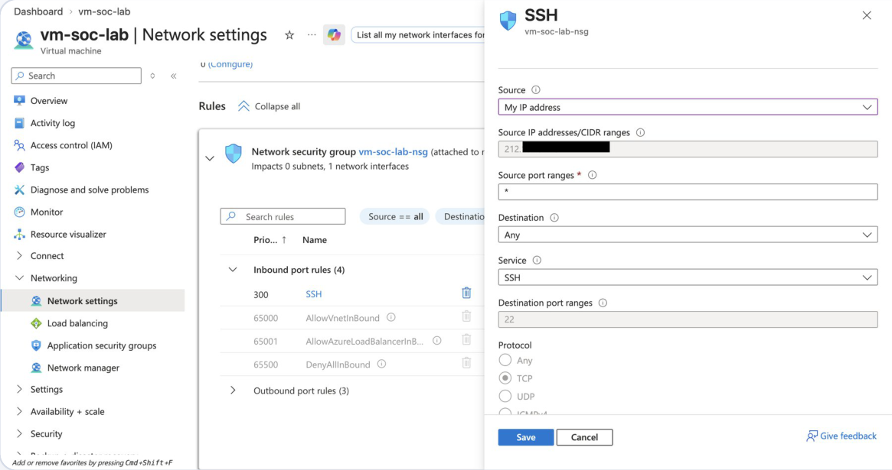

*The SSH rule (priority 300) restricted to one source address with My IP address.*

### 3.3 Connect

```bash
# on your computer
chmod 400 ~/Downloads/vm-soc-lab_key.pem
ssh -i ~/Downloads/vm-soc-lab_key.pem azureuser@<JUMP_PUBLIC_IP>
```

The public IP is on the VM's **Overview** page, or from the Azure CLI:

```bash
az vm show -d -g $RG -n vm-soc-lab --query "{public:publicIps, private:privateIps}" -o table
```

`chmod 400` is needed because SSH refuses a key that other users can read.

### 3.4 Check private name resolution

```bash
# on vm-soc-lab
sudo apt update && sudo apt install -y dnsutils
nslookup <AOAI>.openai.azure.com
```

**Check:** the answer follows the alias to `<AOAI>.privatelink.openai.azure.com` and returns **10.0.1.4**. A public address means the spoke's DNS link (2.3) is missing.

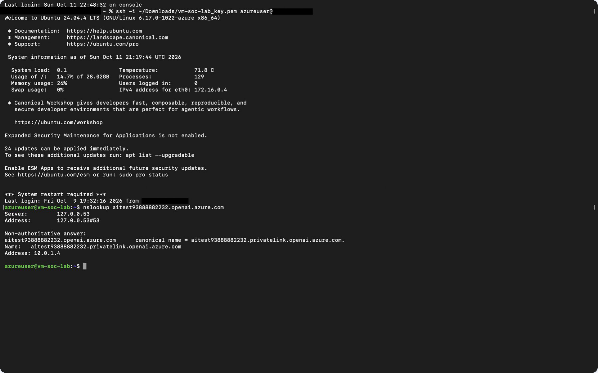

*The jump host resolves the endpoint to 10.0.1.4 through the privatelink alias. This is a build-phase session.*

---

## Part 4 · Keyless access with RBAC

### 4.1 Give the VM an inference-only role

1. In the Azure OpenAI resource, open **Access control (IAM)**, select **+ Add > Add role assignment**.
2. **Role:** search for and select **Cognitive Services OpenAI User**.
3. **Members:** **Assign access to** = **Managed identity**, **+ Select members**, managed identity type **Virtual machine**, select `vm-soc-lab`.
4. **Review + assign**.

**With the Azure CLI**

```bash
MI=$(az vm show -g $RG -n vm-soc-lab --query identity.principalId -o tsv)
az role assignment create --assignee-object-id "$MI" --assignee-principal-type ServicePrincipal \
  --role "Cognitive Services OpenAI User" --scope "$OAI_ID"

# what the role allows
az role definition list --name "Cognitive Services OpenAI User" \
  --query "[0].permissions[0]" -o json
```

This role allows inference but cannot list keys or change the resource, so a compromised VM cannot reconfigure the service. Propagation can take a few minutes. To read exactly what the role allows, open **Access control (IAM) > Roles**, find the role and select **View > JSON**.

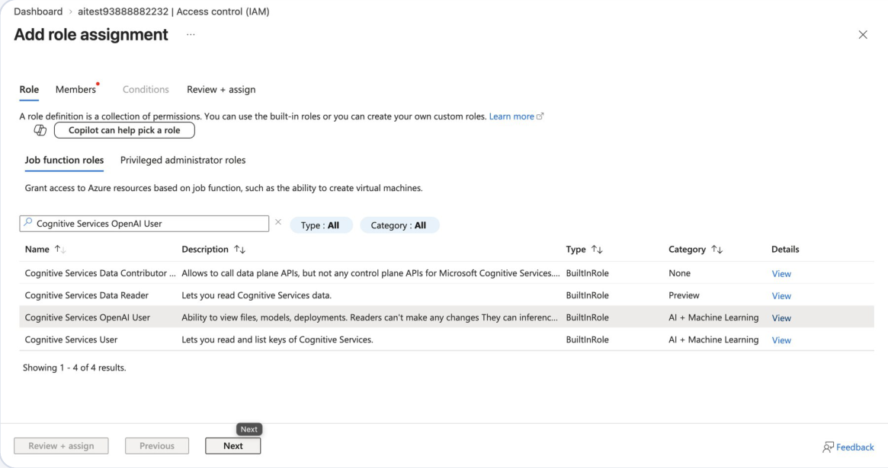

*Choosing the built-in role in Access control (IAM).*

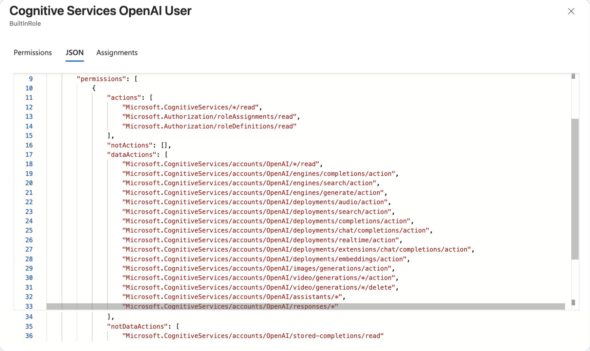

*The role's actions are read-only, and its dataActions are inference operations. Stored completions are excluded.*

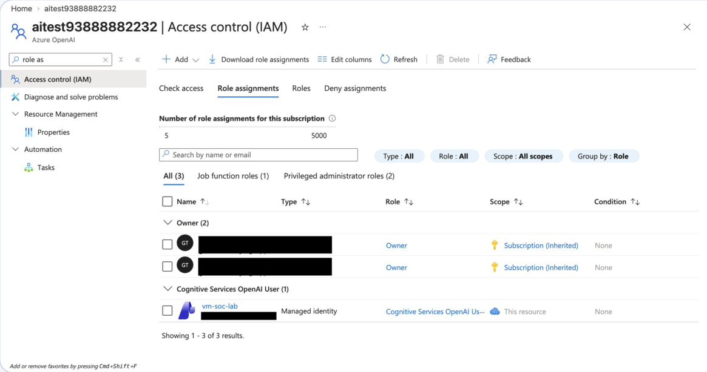

*vm-soc-lab's managed identity holds the role on this resource only.*

### 4.2 Get a token

The token comes from the Instance Metadata Service, which is reachable only from inside the VM:

```bash
# on vm-soc-lab
URL="http://169.254.169.254/metadata/identity/oauth2/token"
URL="$URL?api-version=2018-02-01"
URL="$URL&resource=https://cognitiveservices.azure.com"
TOKEN=$(curl -s -H "Metadata:true" "$URL" | python3 -c \
  "import sys,json; print(json.load(sys.stdin)['access_token'])")
```

Never paste the token anywhere. If you want to inspect it, decode only the payload (`iss`, `aud`, `oid`, `exp`).

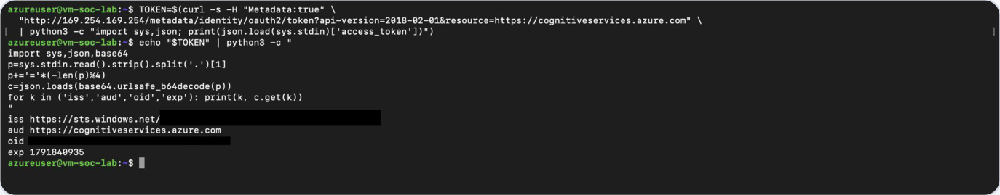

*Decoded claims. The issuer is the tenant, the audience is cognitiveservices.azure.com, and the token expires on its own.*

### 4.3 Validate the whole chain

```bash
# on vm-soc-lab
EP=https://<AOAI>.openai.azure.com
curl -s -o /dev/null -w "%{http_code}\n" \
  -H "Authorization: Bearer $TOKEN" \
  "$EP/openai/models?api-version=2024-10-21"
```

**Check:** the call returns **200**. Together with the private answer from 3.4, this proves the whole chain: private DNS, private path, Entra ID authentication and RBAC authorization.

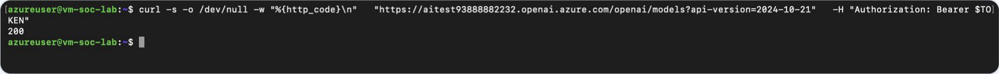

*The data-plane call from the jump host returns 200.*

---

## Part 5 · Query the model from inside the network

Copy the tools to the jump host. The `app` folder is used in Part 7.

```bash
# on your computer, from the repository root
scp -i ~/Downloads/vm-soc-lab_key.pem -r app scripts azureuser@<JUMP_PUBLIC_IP>:~
```

```bash
# on vm-soc-lab
cd ~/scripts && chmod +x ask-openai.py simulate-attack.sh
export AOAI_ENDPOINT=https://<AOAI>.openai.azure.com
export AOAI_DEPLOYMENT=gpt-5-mini
./ask-openai.py                          # interactive chat; /soc switches to SOC analyst mode
./ask-openai.py "Explain MITRE T1110"    # single question
```

I wrote the script with the Python standard library only. Before every request it takes a fresh token from the metadata service, which makes the keyless flow of Part 4 visible step by step. In SOC analyst mode, a system message asks the model to explain what happened, name the most likely ATT&CK technique, judge the severity, and propose next steps and a KQL query.

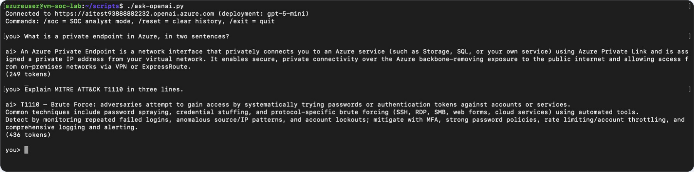

*ask-openai.py in chat mode, connected to the private endpoint with the gpt-5-mini deployment.*

---

## Part 6 · Log Analytics, Microsoft Sentinel and SOC access

### 6.1 Create the workspace

1. Open **Log Analytics workspaces**, select **+ Create**.
2. **Basics:** resource group `rg-soc-lab`, name `law-soc-lab`, region **Italy North** (the DCR in Part 8 must be in the same region).
3. **Review + Create**, then **Create**. The pricing tier is Pay-as-you-go.

**With the Azure CLI**

```bash
az monitor log-analytics workspace create -g $RG -n $WS -l $LOC
echo "WS_ID=$(az monitor log-analytics workspace show -g $RG -n $WS --query id -o tsv)" >> ~/soc-lab.env && source ~/soc-lab.env
```

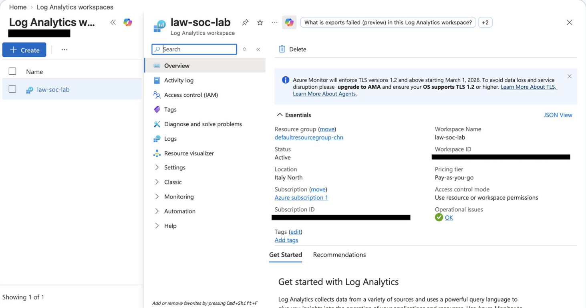

*law-soc-lab, Pay-as-you-go, Italy North.*

### 6.2 Enable Microsoft Sentinel

Open **Microsoft Sentinel**, select **+ Create**, choose `law-soc-lab` and select **Add**. In a company tenant, coordinate this with the security team, because the first workspace onboarded can become the tenant's primary workspace in the Defender portal.

**With the Azure CLI**

```bash
az rest --method put \
  --url "https://management.azure.com$WS_ID/providers/Microsoft.SecurityInsights/onboardingStates/default?api-version=2024-03-01" \
  --body '{"properties":{}}'
```

### 6.3 Retention and daily cap

1. In `law-soc-lab`, open **Settings > Usage and estimated costs**.
2. Select **Data Retention**, set **90 days** and **OK**. Ninety days is the period included with Sentinel.
3. Select **Daily cap**, turn it **On**, set **1 GB/day** and **OK**.

**With the Azure CLI**

```bash
az monitor log-analytics workspace update -g $RG -n $WS --retention-time 90 --quota 1
```

In production I would size the cap well above the expected volume and alert on it, because a cap that stops collection during an attack means lost evidence.

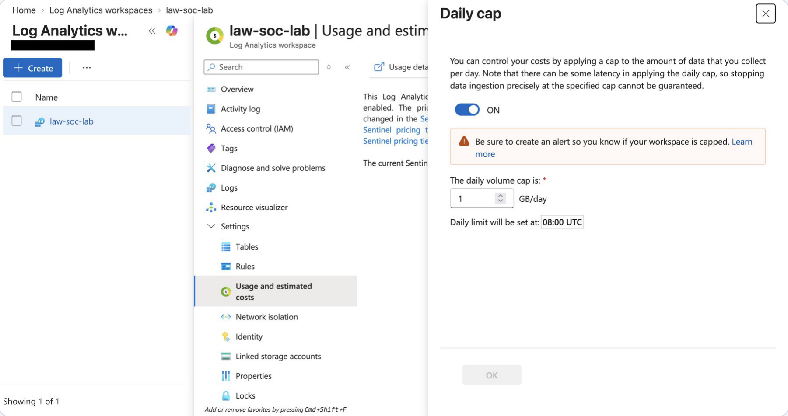

*The daily cap at 1 GB/day.*

### 6.4 SOC groups and roles

**Create the groups.** In the **Microsoft Entra admin center**, open **Groups > All groups > New group**. Group type **Security**, membership type **Assigned**, and create `grp-soc-analysts`, `grp-soc-engineers`, `grp-soc-readers` and `grp-vm-admins`.

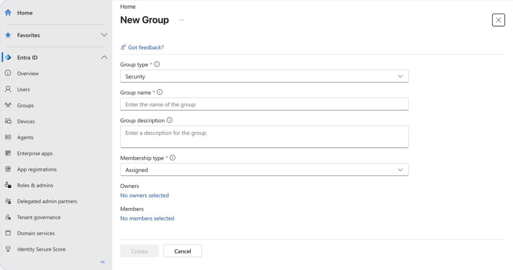

*A Security group with Assigned membership.*

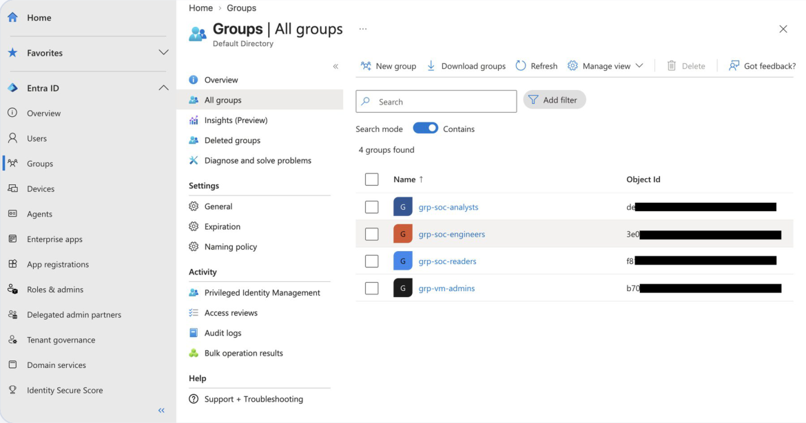

*The four SOC groups.*

**Assign the roles.** Each assignment is made in the resource's **Access control (IAM) > + Add > Add role assignment**, with **Assign access to** = **User, group, or service principal** and the group as member:

| Group | Role | Where to assign it |
| --- | --- | --- |
| `grp-soc-analysts` | Microsoft Sentinel Responder | `law-soc-lab` |
| `grp-soc-engineers` | Microsoft Sentinel Contributor | `law-soc-lab` |
| `grp-soc-engineers` | Cognitive Services OpenAI User | the Azure OpenAI resource |
| `grp-soc-readers` | Microsoft Sentinel Reader | `law-soc-lab` |
| `grp-vm-admins` | Virtual Machine Administrator Login | `rg-soc-lab` (used in Part 10) |

**Add yourself.** Open `grp-vm-admins`, then **Members > + Add members**, select your user and **Select**. Do the same in `grp-soc-engineers`.

**With the Azure CLI**

```bash
for g in grp-soc-analysts grp-soc-engineers grp-soc-readers grp-vm-admins; do
  az ad group create --display-name $g --mail-nickname $g -o none
done

gid() { az ad group show -g "$1" --query id -o tsv; }
assign() { az role assignment create --assignee-object-id "$(gid $1)" \
             --assignee-principal-type Group --role "$2" --scope "$3"; }

assign grp-soc-analysts  "Microsoft Sentinel Responder"        "$WS_ID"
assign grp-soc-engineers "Microsoft Sentinel Contributor"      "$WS_ID"
assign grp-soc-engineers "Cognitive Services OpenAI User"      "$OAI_ID"
assign grp-soc-readers   "Microsoft Sentinel Reader"           "$WS_ID"
assign grp-vm-admins     "Virtual Machine Administrator Login" "$RG_ID"

ME=$(az ad signed-in-user show --query id -o tsv)
az ad group member add --group grp-vm-admins     --member-id "$ME"
az ad group member add --group grp-soc-engineers --member-id "$ME"

# check
az role assignment list --scope "$WS_ID" --query "[].{group:principalName, role:roleDefinitionName}" -o table
```

Roles go to groups, never to people, so joiners and leavers are handled by membership alone.

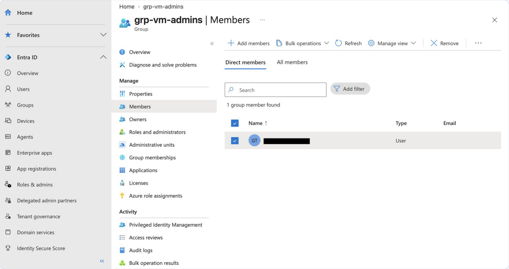

*The administrator as the only member of grp-vm-admins.*

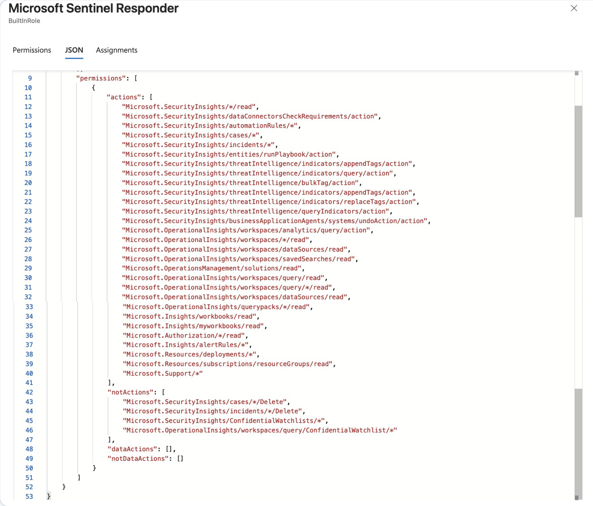

*Microsoft Sentinel Responder. Analysts manage incidents but cannot delete them or read confidential watchlists.*

**Require MFA.** In the Entra admin center, open **Overview > Properties > Manage security defaults** and set it to **Enabled**. Every sign-in behind these roles then requires MFA. Tenants with Entra ID P1 use Conditional Access policies instead.

**With the Azure CLI.** Security defaults are a tenant setting in Microsoft Graph. This works only if your account is allowed to change it (Security Administrator or Global Administrator); otherwise use the portal:

```bash
az rest --method patch \
  --url "https://graph.microsoft.com/v1.0/policies/identitySecurityDefaultsEnforcementPolicy" \
  --body '{"isEnabled": true}'
```

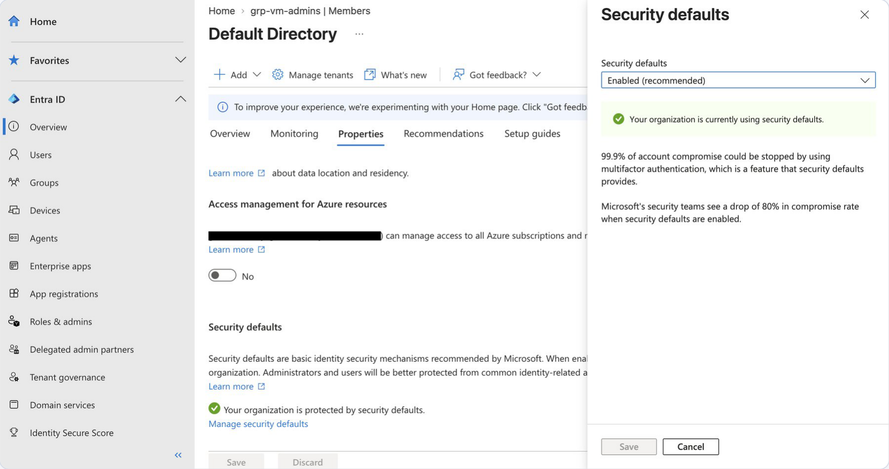

*Security defaults enabled, so every sign-in behind these roles requires MFA.*

---

## Part 7 · The monitored workload

### 7.1 Generate the internal key on the jump host

```bash
# on vm-soc-lab
ssh-keygen -t ed25519 -f ~/.ssh/id_app -N ""
cat ~/.ssh/id_app.pub      # copy this line
```

I generate this key on the jump host so the private key never leaves the network. Part 10 removes it.

### 7.2 Create vm-app-lab with no public IP

Create the VM as in 3.1, with these differences:

| Tab | Field | Value |
| --- | --- | --- |
| Basics | Name | `vm-app-lab` |
| Basics | Authentication | SSH public key, **Use existing public key**, paste the line from 7.1 |
| Basics | Public inbound ports | **None** |
| Networking | Virtual network / subnet | `vnet01` / `subnet-1` |
| Networking | Public IP | **None**: outbound uses the NAT Gateway (2.4) |
| Management | System assigned managed identity | **Enabled**: the Azure Monitor Agent authenticates with it |

**With the Azure CLI**

```bash
APP_KEY='ssh-ed25519 AAAA...id_app... azureuser@vm-soc-lab'     # the line printed in 7.1

az network nsg create -g $RG -n vm-app-lab-nsg -l $LOC
az vm create -g $RG -n vm-app-lab -l $LOC --zone 1 \
  --image Ubuntu2404 --size $VM_SIZE \
  --security-type TrustedLaunch --enable-secure-boot true --enable-vtpm true \
  --vnet-name vnet01 --subnet subnet-1 \
  --public-ip-address "" --nsg vm-app-lab-nsg \
  --admin-username azureuser --ssh-key-values "$APP_KEY" \
  --assign-identity \
  --os-disk-delete-option Delete --nic-delete-option Delete

# check: public is empty; private is <APP_PRIVATE_IP>
az vm show -d -g $RG -n vm-app-lab --query "{public:publicIps, private:privateIps}" -o table
# compare with what vm-app-lab prints for `curl -s ifconfig.me`
az network public-ip show -g $RG -n pip-natgw-soc-lab --query ipAddress -o tsv
```

**Check:** on the VM's **Overview**, the public IP field is empty and the private IP is shown (172.16.0.5 in my build). That private IP is `<APP_PRIVATE_IP>` from now on. Then confirm both directions of the design:

```bash
# on vm-soc-lab
ssh -i ~/.ssh/id_app azureuser@<APP_PRIVATE_IP>
# on vm-app-lab: must print the NAT Gateway's public IP
curl -s ifconfig.me; echo
```

Compare it with the address of `pip-natgw-soc-lab` in the portal.

**Restrict what can reach the target.** By default `AllowVnetInBound` lets every machine in the hub and spoke reach every port of the target. In `vm-app-lab-nsg`, open **Settings > Inbound security rules** and add three rules with **+ Add**:

| Priority | Name | Source | Destination ports | Protocol | Action |
| --- | --- | --- | --- | --- | --- |
| 100 | `allow-jump-ssh-http` | IP addresses: the jump host's private IP `/32` | 22, 80 | TCP | Allow |
| 110 | `allow-bastion-ssh` | IP addresses: `10.0.2.0/26` (the Bastion subnet of Part 10) | 22 | TCP | Allow |
| 4000 | `deny-vnet-inbound` | Service tag: `VirtualNetwork` | Any | Any | Deny |

**With the Azure CLI**

```bash
JUMP_PRIV=$(az vm list-ip-addresses -g $RG -n vm-soc-lab \
  --query "[0].virtualMachine.network.privateIpAddresses[0]" -o tsv)

az network nsg rule create -g $RG --nsg-name vm-app-lab-nsg -n allow-jump-ssh-http \
  --priority 100 --direction Inbound --access Allow --protocol Tcp \
  --source-address-prefixes "$JUMP_PRIV/32" --destination-port-ranges 22 80
az network nsg rule create -g $RG --nsg-name vm-app-lab-nsg -n allow-bastion-ssh \
  --priority 110 --direction Inbound --access Allow --protocol Tcp \
  --source-address-prefixes 10.0.2.0/26 --destination-port-ranges 22
az network nsg rule create -g $RG --nsg-name vm-app-lab-nsg -n deny-vnet-inbound \
  --priority 4000 --direction Inbound --access Deny --protocol '*' \
  --source-address-prefixes VirtualNetwork --source-port-ranges '*' --destination-port-ranges '*'
```

The target now accepts SSH and HTTP only from the jump host and SSH from Bastion, and refuses the rest of the virtual network.

### 7.3 Deploy Acme Workplace

```bash
# on vm-soc-lab
scp -i ~/.ssh/id_app -r ~/app azureuser@<APP_PRIVATE_IP>:~
ssh -i ~/.ssh/id_app azureuser@<APP_PRIVATE_IP>

# on vm-app-lab
cd ~/app && cp deploy/* . && ./install.sh
systemctl status acme nginx --no-pager | grep -E "acme|nginx|Active"
curl -s localhost/health; echo
```

**Check:** both services are `active (running)` and the health check answers `ok`. The stack is nginx on port 80 as a reverse proxy, gunicorn on `127.0.0.1:5000` running as `www-data` under systemd, and the session secret in `/etc/acme.env`, readable only by root.

### 7.4 The security events the application writes

The application writes one key-value event per line to the `auth` syslog facility with the tag `acme-app`, and nginx writes its access log to `local7`:

| Event | Trigger |
| --- | --- |
| `LOGIN_SUCCESS` / `LOGIN_FAILED` | Sign-in attempts (`reason='bad_password'` or `'unknown_user'`) |
| `LOGOUT`, `REGISTER`, `PASSWORD_CHANGED` | Account lifecycle |
| `AUTH_REQUIRED`, `API_UNAUTHORIZED` | Pages or API calls without a session |
| `PRIVILEGE_DENIED`, `ACCESS_DENIED` | Admin console or another user's order |
| `ADMIN_ACCESS`, `ORDER_CREATED` | Administrative and business activity |
| `SUSPICIOUS_INPUT` | SQL injection, XSS, path traversal or command injection patterns |
| `APP_ERROR` | Unhandled server errors |

### 7.5 Open the portal without exposing it

```bash
# on your computer
ssh -N -i ~/Downloads/vm-soc-lab_key.pem -L 8080:<APP_PRIVATE_IP>:80 azureuser@<JUMP_PUBLIC_IP>
```

Browse to `http://localhost:8080`. The installer creates the test accounts `alice`, `bob` and `admin`. After Part 10, the same access goes through a Bastion tunnel.

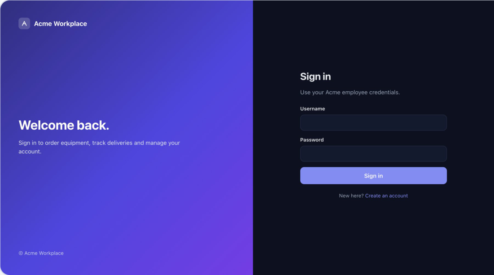

*The sign-in page, reached through the SSH tunnel.*

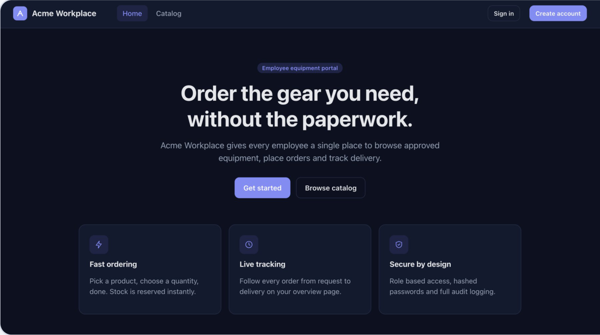

*The landing page.*

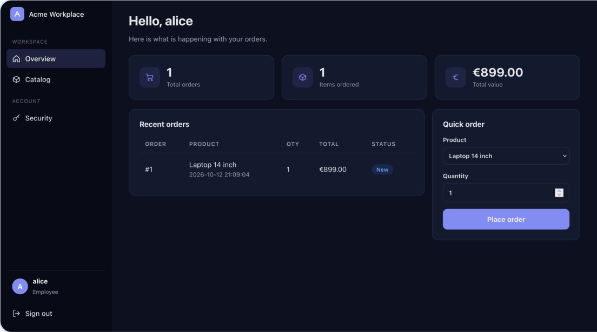

*An employee's overview after an order.*

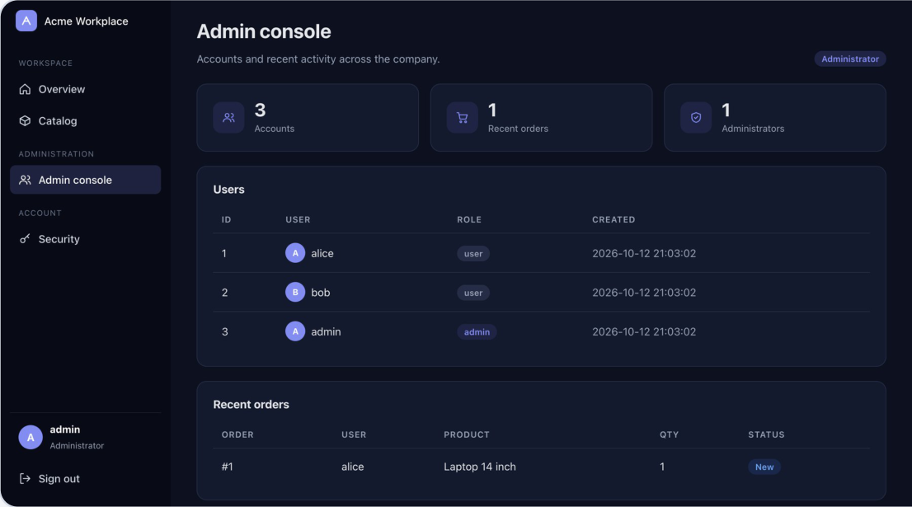

*The admin console, with the three test accounts.*

---

## Part 8 · Log collection

### 8.1 Create the Data Collection Rule

Open **Monitor > Settings > Data Collection Rules** and select **+ Create**.

1. **Basics:** name `dcr-soc-lab-syslog`, resource group `rg-soc-lab`, region **Italy North**, type of telemetry **Linux**. No data collection endpoint and no user-assigned identity.
2. **Resources:** **+ Add resources**, select `vm-soc-lab` and `vm-app-lab`. The association installs the Azure Monitor Agent, which authenticates with each VM's managed identity.
3. **Collect and deliver:** **+ Add data source**, type **Linux Syslog**, set the levels from 8.2. On the **Destination** tab, **Azure Monitor Logs** with the workspace `law-soc-lab`. Select **Add data source**.
4. **Review + create**, then **Create**.

**With the Azure CLI.** From the command line, the rule, the agent and the association are three separate steps. The rule file carries the facilities and levels of 8.2:

```bash
cat > dcr-soc-lab-syslog.json <<EOF
{
  "location": "$LOC",
  "kind": "Linux",
  "properties": {
    "dataSources": {
      "syslog": [
        { "name": "required-info", "streams": ["Microsoft-Syslog"],
          "facilityNames": ["auth", "authpriv", "local7"],
          "logLevels": ["Info", "Notice", "Warning", "Error", "Critical", "Alert", "Emergency"] },
        { "name": "baseline-warning", "streams": ["Microsoft-Syslog"],
          "facilityNames": ["cron", "daemon", "kern", "syslog", "user"],
          "logLevels": ["Warning", "Error", "Critical", "Alert", "Emergency"] }
      ]
    },
    "destinations": { "logAnalytics": [ { "name": "law", "workspaceResourceId": "$WS_ID" } ] },
    "dataFlows": [ { "streams": ["Microsoft-Syslog"], "destinations": ["law"] } ]
  }
}
EOF
az monitor data-collection rule create -g $RG -n dcr-soc-lab-syslog -l $LOC --rule-file dcr-soc-lab-syslog.json
DCR_ID=$(az monitor data-collection rule show -g $RG -n dcr-soc-lab-syslog --query id -o tsv)

# the portal installs the agent for you; from the CLI it is explicit
for vm in vm-soc-lab vm-app-lab; do
  az vm extension set -g $RG --vm-name $vm --name AzureMonitorLinuxAgent \
    --publisher Microsoft.Azure.Monitor --enable-auto-upgrade true
  az monitor data-collection rule association create --name "dcra-$vm" \
    --rule-id "$DCR_ID" --resource "$(az vm show -g $RG -n $vm --query id -o tsv)"
done
```

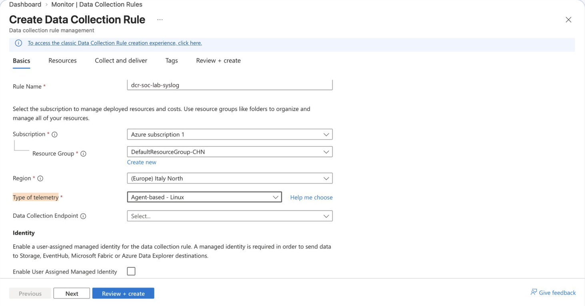

*The Basics tab, Agent-based – Linux, with no data collection endpoint and no user-assigned identity.*

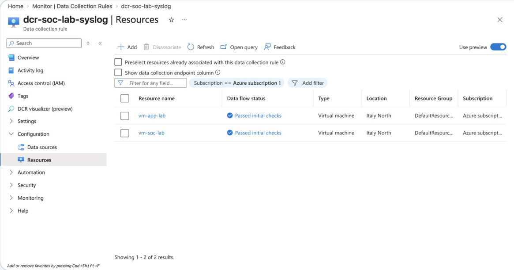

*Both VMs associated with the rule, data flow Passed initial checks.*

### 8.2 Syslog facilities and levels

| Facility | Minimum level | Why |
| --- | --- | --- |
| `LOG_AUTH` | `LOG_INFO` | Acme application events (required) |
| `LOG_AUTHPRIV` | `LOG_INFO` | SSH logins, sudo, su (required) |
| `LOG_LOCAL7` | `LOG_INFO` | nginx access log (required) |
| `LOG_CRON` | `LOG_WARNING` | Persistence through scheduled jobs (T1053.003) |
| `LOG_DAEMON` | `LOG_WARNING` | New or stopped services (T1543.002) |
| `LOG_KERN` | `LOG_WARNING` | Kernel modules, packet filter drops |
| `LOG_SYSLOG`, `LOG_USER` | `LOG_WARNING` | Logging failures, generic process errors |

Set every other facility to **none**. The minimum level is a threshold: the agent collects that level and every more severe one.

### 8.3 Verify the agent

1. On each VM, open **Settings > Extensions + applications**: `AzureMonitorLinuxAgent` must show **Provisioning succeeded**.
2. On the machine itself, the service must be running:

```bash
# on vm-app-lab
systemctl status azuremonitoragent --no-pager | head -5        # active (running)
```

**With the Azure CLI**, the extension state of each VM:

```bash
for vm in vm-soc-lab vm-app-lab; do
  az vm extension list -g $RG --vm-name $vm --query "[].{name:name, state:provisioningState}" -o table
done
```

3. In `law-soc-lab > Logs`, the `Heartbeat` table shows the last record from every machine:

```kql
Heartbeat
| summarize LastSeen = max(TimeGenerated) by Computer
```

Any KQL query in this tutorial can also run from Cloud Shell:

```bash
WS_GUID=$(az monitor log-analytics workspace show -g $RG -n $WS --query customerId -o tsv)
az monitor log-analytics query -w "$WS_GUID" -o table \
  --analytics-query "Heartbeat | summarize LastSeen = max(TimeGenerated) by Computer"
```

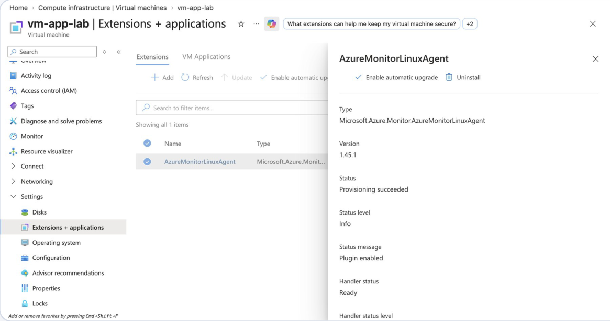

*AzureMonitorLinuxAgent on vm-app-lab, Provisioning succeeded.*

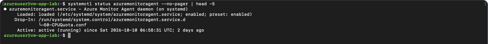

*The agent service active on vm-app-lab.*

### 8.4 Send the Azure OpenAI logs to the workspace

1. In the Azure OpenAI resource, open **Monitoring > Diagnostic settings** and select **+ Add diagnostic setting**.
2. Name `diag-openai-to-law`. Under **Logs**, tick **allLogs**; under **Metrics**, tick **AllMetrics**.
3. **Destination details:** **Send to Log Analytics workspace**, `law-soc-lab`.
4. Select **Save**.

**With the Azure CLI**

```bash
az monitor diagnostic-settings create --name diag-openai-to-law \
  --resource "$OAI_ID" --workspace "$WS_ID" \
  --logs '[{"categoryGroup":"allLogs","enabled":true}]' \
  --metrics '[{"category":"AllMetrics","enabled":true}]'
```

After a few calls from the jump host:

```kql
AzureDiagnostics
| where ResourceProvider == "MICROSOFT.COGNITIVESERVICES"
| summarize Calls = count() by OperationName, ResultSignature
```

These records describe each request (operation, caller, status, duration), not the prompts or the completions.

---

## Part 9 · Validate the pipeline and simulate an attack

### 9.1 Pipeline check

In **law-soc-lab > Logs**, in KQL mode:

```kql
Syslog
| where TimeGenerated > ago(1h)
| where Facility in ("auth", "authpriv", "local7")
| summarize Events = count(), Last = max(TimeGenerated) by Computer, Facility, ProcessName
| order by Facility asc, Computer asc
```

**With the Azure CLI**, the same query from Cloud Shell:

```bash
WS_GUID=$(az monitor log-analytics workspace show -g $RG -n $WS --query customerId -o tsv)
az monitor log-analytics query -w "$WS_GUID" -o table --analytics-query '
Syslog
| where TimeGenerated > ago(1h)
| where Facility in ("auth", "authpriv", "local7")
| summarize Events = count(), Last = max(TimeGenerated) by Computer, Facility, ProcessName
| order by Facility asc, Computer asc'
```

**Check:** you see `auth` and `authpriv` rows from both VMs, and `local7` rows from `vm-app-lab` only. The first events take 5 to 10 minutes. In my build, nginx's syslog tag was parsed as the host name, so `ProcessName` read `vm-app-lab` for `local7`.

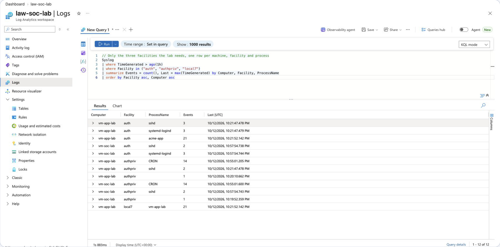

*auth and authpriv from both VMs, local7 and acme-app from vm-app-lab.*

### 9.2 Run the attack

```bash
# on vm-soc-lab
cd ~/scripts && ./simulate-attack.sh <APP_PRIVATE_IP>
```

The script sends 12 wrong passwords for `admin` (MITRE ATT&CK T1110.001), tries 5 common usernames, sends SQL injection, XSS and path traversal probes, and calls the orders API without a session.

### 9.3 Observe it

```kql
Syslog
| where TimeGenerated > ago(1h)
| where ProcessName == "acme-app"
| extend
    Event = extract(@"^(\w+)", 1, SyslogMessage),
    User  = extract(@"user='([^']+)'", 1, SyslogMessage),
    IP    = extract(@"ip=([0-9\.]+)", 1, SyslogMessage)
| project TimeGenerated, Computer, Event, User, IP, SyslogMessage
| order by TimeGenerated desc
```

```kql
Syslog
| where TimeGenerated > ago(24h)
| where ProcessName == "acme-app"
| extend Event = extract(@"^(\w+)", 1, SyslogMessage)
| summarize Count = count() by Computer, Event
| order by Count desc
```

**Check:** the attack adds **17 `LOGIN_FAILED`**, **3 `SUSPICIOUS_INPUT`** and **1 `API_UNAUTHORIZED`**, all from the jump host's private address.

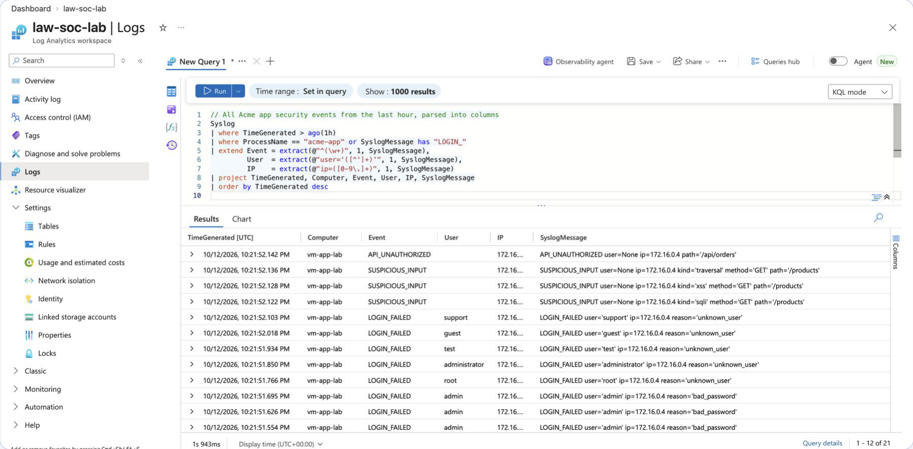

*The attack parsed into columns, from 172.16.0.4. My first query also matched `or SyslogMessage has "LOGIN_"`, which the query above drops.*

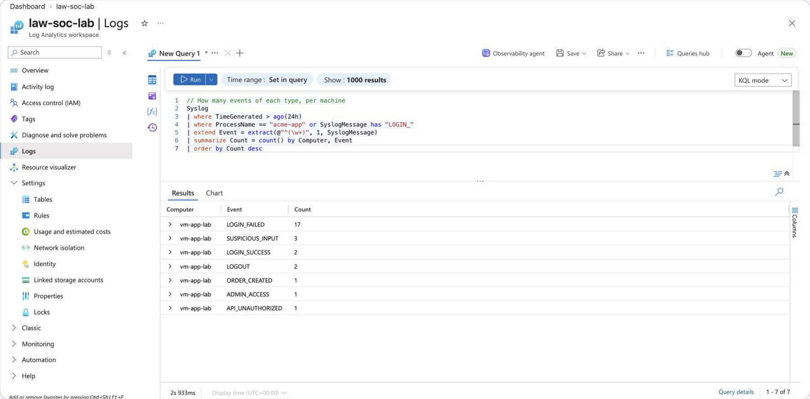

*17 failed sign-ins, 3 suspicious inputs and 1 unauthorized API call, against 2 successful sign-ins. The query in the screenshot also matched `or SyslogMessage has "LOGIN_"`, which the query above drops.*

> [!WARNING]
> The key-value format is parsed with regular expressions, and the values are attacker-controlled. A username containing a quote and a fake `ip=` field can forge the parsed source address. Production logs JSON and parses it with `parse_json()`. Also, the attacker here is the jump host, which is the administrator's own machine: any automatic block must exclude it.

### 9.4 Ask the model to assess the events

```bash
# on vm-soc-lab
ssh -i ~/.ssh/id_app azureuser@<APP_PRIVATE_IP> \
  "sudo journalctl -t acme-app -n 50 --no-pager" \
  | ./ask-openai.py --soc "Assess these events"
```

In SOC mode the model explains what happened, names the most likely ATT&CK technique, judges severity and proposes next steps and a KQL query. It returns text only, and the analyst decides. Reading logs over SSH with sudo is a shortcut: in production the events come from Log Analytics. The command uses the internal key from 7.1 to reach `vm-app-lab` on its private address, so it works only until step 10.3 removes that key.


*Illustration: the kind of assessment SOC mode returns for the events of 9.3. The wording of the answer varies between runs.*

---

## Part 10 · Azure Bastion and Entra ID login

With everything validated, I move administration to the final model: no public IP on any VM, no SSH key, and every administrator signs in with their own Entra ID identity.

### 10.1 Deploy Azure Bastion in the hub

1. Open **Bastions**, select **+ Create**.
2. **Basics:** resource group `rg-soc-lab`, name `bas-soc-lab`, region **Italy North**, tier **Standard**.
3. **Virtual network:** `vnet-openai`. Select **Manage subnet configuration** and add a subnet named `AzureBastionSubnet` with `10.0.2.0/26`, then go back to the Bastion wizard.
4. **Public IP address:** **Create new**, name `pip-bas-soc-lab`.
5. **Advanced:** tick **Native client support**, needed for the CLI connection and tunnel in 10.4.
6. **Review + create**, then **Create**. Deployment takes about ten minutes.

**With the Azure CLI**

```bash
az network vnet subnet create -g $RG --vnet-name vnet-openai \
  -n AzureBastionSubnet --address-prefixes 10.0.2.0/26
az network public-ip create -g $RG -n pip-bas-soc-lab --sku Standard --allocation-method Static
# --enable-tunneling turns on native client support
az network bastion create -g $RG -n bas-soc-lab -l $LOC \
  --vnet-name vnet-openai --public-ip-address pip-bas-soc-lab \
  --sku Standard --enable-tunneling true
```

The public address belongs to the managed service, not to any VM, and accepts only TLS connections from authenticated users. Bastion reaches the VMs in the spoke on their private IPs through the peering.

### 10.2 Enable Entra ID login on both VMs

1. In `vm-soc-lab`, open **Settings > Extensions + applications**, select **+ Add**, choose the Entra ID SSH login extension for Linux (`AADSSHLoginForLinux`, listed as *Azure AD based SSH Login*), and create it.
2. Repeat on `vm-app-lab`.

**With the Azure CLI**

```bash
for vm in vm-soc-lab vm-app-lab; do
  az vm extension set -g $RG --vm-name $vm \
    --publisher Microsoft.Azure.ActiveDirectory --name AADSSHLoginForLinux
done
```

The VMs reach Entra ID to validate certificates and roles through the NAT Gateway. `grp-vm-admins` already holds **Virtual Machine Administrator Login** on the resource group (6.4), which gives sudo.

**Give the administrators Reader where Bastion needs it.** Opening a Bastion session also requires **Reader** on the VM, its network interface and the Bastion resource. In each of these five resources (`vm-soc-lab`, `vm-app-lab`, the two network interfaces and `bas-soc-lab`), open **Access control (IAM) > + Add > Add role assignment**, role **Reader**, member `grp-vm-admins`. I don't give Reader on the whole resource group, because that would let VM administrators read the workspace and the Sentinel incidents too.

**With the Azure CLI**

```bash
GID=$(az ad group show -g grp-vm-admins --query id -o tsv)
BAS=$(az network bastion show -g $RG -n bas-soc-lab --query id -o tsv)
# each VM, its network interface, and Bastion
for id in $(az vm list -g $RG --query "[].[id, networkProfile.networkInterfaces[0].id]" -o tsv) $BAS; do
  az role assignment create --assignee-object-id "$GID" \
    --assignee-principal-type Group --role Reader --scope "$id"
done
```

### 10.3 Remove the public entry point and the keys

**Detach and delete the jump host's public IP**

1. In `vm-soc-lab`, open **Networking > Network settings** and select the network interface.
2. Open **Settings > IP configurations**, select `ipconfig1`, clear **Associate public IP address** and **Save**.
3. Open the public IP resource `vm-soc-lab-ip` and select **Delete**. A detached address would still be billed.

**Delete the SSH rule.** In `vm-soc-lab > Networking > Network settings`, select the inbound rule **SSH** and **Delete**. Bastion reaches the jump host through the default `AllowVnetInBound` rule, and the target through its `allow-bastion-ssh` rule from 7.2.

**Remove the SSH keys.** In each VM, open **Operations > Run command > RunShellScript**, paste the script and select **Run**:

```bash
# Run command on vm-soc-lab: remove the build-phase key and the internal key
truncate -s 0 /home/azureuser/.ssh/authorized_keys; rm -f /home/azureuser/.ssh/id_app*
```

```bash
# Run command on vm-app-lab: remove the internal key
sed -i '/azureuser@vm-soc-lab/d' /home/azureuser/.ssh/authorized_keys
```

**With the Azure CLI**

```bash
# detach and delete the public IP
NIC=$(az vm show -g $RG -n vm-soc-lab --query "networkProfile.networkInterfaces[0].id" -o tsv)
IPCFG=$(az network nic show --ids "$NIC" --query "ipConfigurations[0].name" -o tsv)
az network nic ip-config update --ids "$NIC/ipConfigurations/$IPCFG" --remove publicIpAddress
az network public-ip delete -g $RG -n vm-soc-lab-ip

# delete the SSH rule
az network nsg rule delete -g $RG --nsg-name vm-soc-lab-nsg -n SSH

# remove the keys through Run command
az vm run-command invoke -g $RG -n vm-soc-lab --command-id RunShellScript --scripts \
  "truncate -s 0 /home/azureuser/.ssh/authorized_keys; rm -f /home/azureuser/.ssh/id_app*"
az vm run-command invoke -g $RG -n vm-app-lab --command-id RunShellScript --scripts \
  "sed -i '/azureuser@vm-soc-lab/d' /home/azureuser/.ssh/authorized_keys"
```

Run command executes through the Azure VM agent, so it works without SSH. From this point neither VM has a public IP, no NSG has an inbound rule from the internet, and no SSH key opens either VM.

### 10.4 Connect through Bastion and validate

**From the portal:** open `vm-soc-lab`, select **Connect > Connect via Bastion**, set **Authentication Type** to **Microsoft Entra ID** and **Connect**.

**From your terminal**, with the Azure CLI and its `bastion` and `ssh` extensions:

```bash
# on your computer
az login
az network bastion ssh -n bas-soc-lab -g rg-soc-lab \
  --target-resource-id "$(az vm show -g rg-soc-lab -n vm-soc-lab --query id -o tsv)" --auth-type AAD

# the Acme portal, now through Bastion: then browse to http://localhost:8080
az network bastion tunnel -n bas-soc-lab -g rg-soc-lab \
  --target-resource-id "$(az vm show -g rg-soc-lab -n vm-app-lab --query id -o tsv)" \
  --resource-port 80 --port 8080
```

**Check:** `whoami` on the VM returns your Entra ID user principal name, neither VM shows a public IP on its **Overview**, and the old private key no longer opens a session.

### 10.5 Next step: automation

A Sentinel analytics rule raises an incident on 5 or more failed sign-ins from one address in 10 minutes. A playbook on **Logic Apps Standard with VNet integration** (the Consumption plan cannot reach a private endpoint) sends the events to the model with its own managed identity and writes the assessment on the incident. The analyst approves or dismisses a temporary block. The guide describes the full design.

---

## Teardown

One command in Cloud Shell deletes the whole lab, because everything lives in one resource group:

```bash
az group delete --name rg-soc-lab --yes
```

It removes the VMs, the networks, Bastion, the NAT Gateway, the private endpoint, Azure OpenAI, the workspace and the policy assignments scoped to the group. Two things live outside the resource group and stay: the four `grp-` groups in Entra ID, which you delete under **Groups**, and the soft-deleted Azure OpenAI resource, which keeps its name reserved until you purge it under **Azure AI services > Manage deleted resources**. If the workspace is onboarded to the Defender portal, disconnect it first under **Settings > Microsoft Sentinel > SIEM workspaces**.

To pause instead of deleting, open each VM and select **Stop**, or run `az vm deallocate -g $RG -n <vm> --no-wait`: this deallocates it and stops compute billing, which a shutdown from inside the OS does not do. Bastion bills per hour while it exists, so delete it when nobody needs it.

## Troubleshooting

| Symptom | Likely cause | Fix |
| --- | --- | --- |
| `nslookup` returns a public address | The spoke is not linked to the private DNS zone | Step 2.3 |
| `401` from the model | Token missing or expired | Request a new token (4.2) |
| `403` mentioning a virtual network or public access | The request did not go through the private endpoint | Repeat 3.4 and check DNS |
| `403` with `PermissionDenied` | Role missing or not yet propagated | Step 4.1, wait a few minutes |
| No rows in `Syslog` | Agent not installed or DCR not associated | Step 8.3; wait 5 to 10 minutes |
| `curl ifconfig.me` on the target hangs | NAT Gateway not associated with `subnet-1` | Step 2.4 |
| The jump host cannot reach the target | The private IP in `allow-jump-ssh-http` is wrong | Step 7.2 |
| Creating a resource fails with `RequestDisallowedByPolicy` | A policy from 0.2 or 1.7 blocks it | Check the region, the network access and the key setting |
| Bastion with Entra ID refuses the login | Missing role or extension | Steps 6.4 and 10.2 |

The guide's **Known limitations** slide lists what I would change after reviewing the build, and how.
